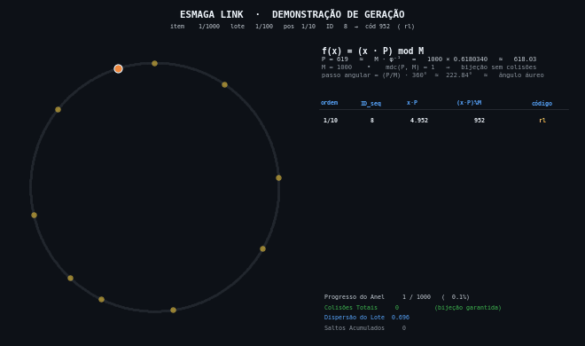
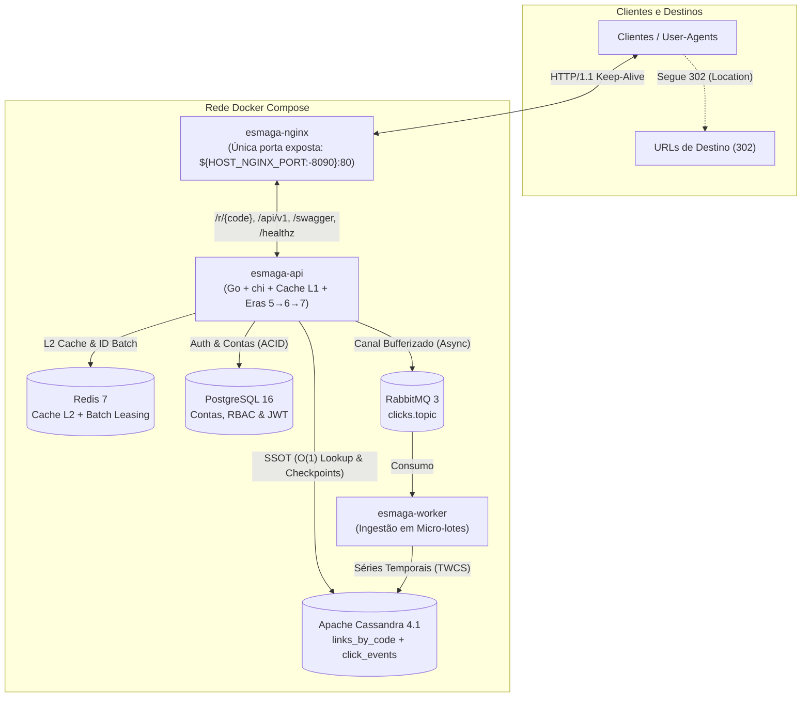

# Esmaga Link: Plataforma de Encurtamento de Alta Vazão e Telemetria


> **Idioma / Language:** **Português (Brasil)** | [Read in English (README_EN.md)](README_EN.md)

O **Esmaga Link** é uma plataforma distribuída de encurtamento de URLs e telemetria analítica projetada para cenários de altíssima concorrência. Construído sob arquitetura orientada a eventos e isolamento estrito de carga (CQRS), o sistema sustenta redirecionamentos de baixa latência ($P99 < 50\text{ms}$).

Seu núcleo abandona geradores aleatórios e travas em banco de dados em favor de uma **bijeção modular determinística** sobre anel finito: geração em tempo $O(1)$, reversibilidade local sem I/O e **zero colisões por construção algébrica**.



*Cada frame ilustra um lote de IDs sendo consumido em ordem intra-lote permutada (mecanismo aplicado deliberadamente em cada instância para impedir correlação sequencial), cuja entropia é ainda mais amplificada com múltiplos nós concorrentes. O rastro em amarelo evidencia que os 10 IDs já chegam dispersos ao anel antes mesmo do primeiro acesso, sendo assim a prova visual de que a dispersão espacial independe da ordem de consumo.*

---

## Principais Garantias Arquiteturais

| Propriedade                      | Mecanismo                                              | Benefício Prático                                      |
| :------------------------------- | :----------------------------------------------------- | :----------------------------------------------------- |
| **Zero colisões**                | Prova algébrica via $\gcd(P, M) = 1$ (Seção 1.6)       | Elimina `SELECT before INSERT` e retentativas          |
| **Geração em $O(1)$**            | $f(x) = (x \cdot P) \bmod M$                           | Aritmética pura em CPU, sem I/O de rede ou disco       |
| **Dispersão uniforme**           | Multiplicador derivado de $\phi^{-1}$ (razão áurea)    | Evita enumeração sequencial previsível                 |
| **Reversibilidade local**        | Inverso modular $P^{-1}$ via Euclides Estendido        | Decodificação direta em memória, sem consulta ao banco |
| **APIs *stateless***             | Batch Leasing no Redis + `sync/atomic` em memória      | Escala horizontal sem coordenação entre nós            |
| **Hot Path $P99 < 50\text{ms}$** | CQRS + Cache L1/L2 + resposta `302` sem *body allocation* | Telemetria assíncrona nunca degrada o redirecionamento |
| **Resiliência SSOT**             | Cassandra como fonte única da verdade + LWT (Paxos)    | Recuperação automática contra perda total do Redis     |

---

## Sumário

- [Esmaga Link: Plataforma de Encurtamento de Alta Vazão e Telemetria](#esmaga-link-plataforma-de-encurtamento-de-alta-vazão-e-telemetria)
  - [Principais Garantias Arquiteturais](#principais-garantias-arquiteturais)
  - [Sumário](#sumário)
  - [1. A Decisão Matemática](#1-a-decisão-matemática)
    - [1.1. Por que rejeitamos as abordagens convencionais](#11-por-que-rejeitamos-as-abordagens-convencionais)
    - [1.2. A solução: Eras progressivas e mapeamento bijetor em anel finito](#12-a-solução-eras-progressivas-e-mapeamento-bijetor-em-anel-finito)
    - [1.3. Dispersão uniforme e escolha das constantes](#13-dispersão-uniforme-e-escolha-das-constantes)
    - [1.4. Segunda camada: ofuscação lexical](#14-segunda-camada-ofuscação-lexical)
    - [1.5. Reversibilidade em O(1)](#15-reversibilidade-em-o1)
    - [1.6. Prova formal de ausência de colisões](#16-prova-formal-de-ausência-de-colisões)
  - [2. Arquitetura de Alto Nível](#2-arquitetura-de-alto-nível)
  - [3. Stack Tecnológico](#3-stack-tecnológico)
  - [4. Operação e Escala](#4-operação-e-escala)
    - [4.1. Isolamento de caminhos (Hot vs. Cold)](#41-isolamento-de-caminhos-hot-vs-cold)
    - [4.2. Batch Leasing](#42-batch-leasing)
    - [4.3. Resiliência e recuperação](#43-resiliência-e-recuperação)
  - [5. Segurança de Borda](#5-segurança-de-borda)
  - [6. Contratos da API HTTP](#6-contratos-da-api-http)
    - [6.1. Criação de shortcodes](#61-criação-de-shortcodes)
    - [6.2. Redirecionamento (Hot Path)](#62-redirecionamento-hot-path)
    - [6.3. Fluxo autenticado via cURL](#63-fluxo-autenticado-via-curl)
  - [7. Testes e Verificação](#7-testes-e-verificação)
  - [8. Como Executar](#8-como-executar)

---

## 1. A Decisão Matemática

Todo encurtador de URLs de alta escala precisa resolver um dilema fundamental: **como gerar códigos curtos e únicos em paralelo, sem coordenação entre nós, sem colisões e sem consultas prévias ao banco?** Abordagens tradicionais sacrificam pelo menos um desses requisitos.

### 1.1. Por que rejeitamos as abordagens convencionais

| Abordagem                | Complexidade | Colisões | Reversível | Ofuscação | Limitação Estrutural                                       |
| :----------------------- | :----------: | :------: | :--------: | :-------: | :--------------------------------------------------------- |
| `AUTO_INCREMENT` central |    $O(1)$    |   Zero   |    Sim     |  Nenhuma  | Ponto único de contenção; quebra o modelo *stateless*      |
| UUID v4                  |    $O(1)$    |   Nula   |    Sim     |  Nenhuma  | 128 bits (longo demais para URLs); fragmentação de índices |
| Hash truncado (MD5/SHA)  |    $O(1)$    | **Sim**  |    Não     |    Boa    | Paradoxo do Aniversário; exige `SELECT before INSERT`      |
| Snowflake                |    $O(1)$    |   Zero   |    Sim     |   Fraca   | Ordenável por timestamp e previsível por inspeção          |
| NanoID / PRNG            |    $O(1)$    | **Sim**  |    Não     |    Boa    | Sem reversibilidade; exige verificação de unicidade        |

O objetivo era encontrar uma função $f: \mathbb{Z}_M \to \mathbb{Z}_M$ que fosse simultaneamente **bijetora** (zero colisões garantidas), **inversível** (reversão local sem banco) e **geometricamente dispersa** (resistente à inferência por análise de frequência). A solução foi a **multiplicação modular coprima sobre um anel finito**, calibrada pela razão áurea.

### 1.2. A solução: Eras progressivas e mapeamento bijetor em anel finito

Para entregar códigos curtos desde o início sem desperdiçar espaço nem arriscar colisões ao crescer, o gerador organiza os códigos em **Eras progressivas por comprimento ($5 \to 6 \to 7$ caracteres)**, com preenchimento à esquerda (*padding* pelo primeiro caractere do alfabeto):

- **Era 5 ($62^5$):** `916.132.832` (~916 milhões de códigos com 5 caracteres)
- **Era 6 ($62^6$):** `56.800.235.584` (~56,8 bilhões de códigos com 6 caracteres)
- **Era 7 ($62^7$):** `3.521.614.606.208` (~3,52 trilhões de códigos com 7 caracteres)

Como cada era possui um comprimento fixo distinto, **as eras são estritamente disjuntas por tamanho**, um código de 5 caracteres nunca colide com um de 6 ou 7, permitindo aproveitar **100% de cada universo $M_k = 62^k$**.

Dentro de cada era, a ofuscação utiliza um **LCG (*Linear Congruential Generator*) de período completo** validado pelo **Teorema de Hull-Dobell**, calculado em tempo $O(\log n)$ sem estado iterativo:

$$\text{ID}_{\text{obfuscated}} = T^n(\text{seed}) \pmod{M_k}, \quad T(x) = (A \cdot x + C) \bmod M_k$$

Onde:
- $n$ é o índice local do `seqID` dentro da era atual (alocado em lote no Redis e permutado em memória).
- $A$ e $C$ satisfazem as 3 condições de Hull-Dobell ($\gcd(C, M_k) = 1$, $(A - 1)$ divisível pelos fatores primos de $M_k$ e $4 \mid (A - 1)$), garantindo um **ciclo Hamiltoniano completo** sobre todo $\mathbb{Z}_{M_k}$.

### 1.3. Dispersão uniforme e escolha das constantes

Em cada era, as constantes $(A, C)$ (ou o multiplicador coprimo $P \approx M \cdot \phi^{-1}$ no modo multiplicativo) garantem dispersão espacial uniforme sem agrupamentos previsíveis:

$$\phi^{-1} = \frac{\sqrt{5} - 1}{2} \approx 0.6180339887\ldots$$

Assim, incrementos unitários fragmentam o espaço lógico de forma quase uniforme, emulando a aparência de aleatoriedade, mas preservando **determinismo, período completo e zero colisões**.

### 1.4. Segunda camada: ofuscação lexical

Converter inteiros usando alfabetos ordenados (`0123...XYZ`) expõe padrões triviais nos dígitos mais significativos. Para eliminar essa assinatura, o dicionário Base62 passa por um embaralhamento **Fisher-Yates** determinado por semente estática em tempo de compilação:

- **Alfabeto Base62 padrão:** `0123456789abcdefghijklmnopqrstuvwxyzABCDEFGHIJKLMNOPQRSTUVWXYZ`
- **Alfabeto permutado do sistema:** `zWv6UYRb9tIGpKVrc2EFw1lTHemsSjqC5a03DL7Z4QPBdJyNhiouAMXgfxn8Ok`

A combinação da bijeção modular com o alfabeto permutado impede a predição da sequência sem o conhecimento simultâneo da constante $P$ e do vetor léxico.

### 1.5. Reversibilidade em O(1)

Pela Identidade de Bézout, $\gcd(P, M) = 1$ garante a existência de um único inverso multiplicativo modular $P^{-1}$ calculado via Algoritmo Euclidiano Estendido:

$$(P \cdot P^{-1}) \equiv 1 \pmod M$$

Com $P^{-1}$ pré-computado **uma única vez na inicialização da aplicação**, qualquer código é revertido ao seu ID sequencial original em sub-microssegundos:

$$\text{ID}_{\text{seq}} = (\text{ID}_{\text{ofuscado}} \cdot P^{-1}) \pmod M$$

### 1.6. Prova formal de ausência de colisões

**Teorema.** A função $f(x) = (x \cdot P) \bmod M$ é estritamente bijetora se, e somente se, $\gcd(P, M) = 1$.

**Prova.** Suponha, por absurdo, que existam $x_1 \neq x_2$ com $x_1, x_2 \in [0, M-1]$ tais que $f(x_1) = f(x_2)$:

$$(x_1 \cdot P) \equiv (x_2 \cdot P) \pmod M$$

Pela definição de congruência modular, $M$ divide a diferença:

$$M \mid P(x_1 - x_2)$$

Aplicando o Lema de Euclides com a premissa $\gcd(P, M) = 1$:

$$M \mid (x_1 - x_2)$$

Como $x_1, x_2 \in [0, M-1]$, segue que $\vert{}x_1 - x_2\vert{} < M$. O único múltiplo de $M$ nesse intervalo é $0$, o que implica $x_1 - x_2 = 0 \implies x_1 = x_2$, contradizendo a hipótese inicial. $\blacksquare$

**Consequências para a engenharia:**
- **Zero locks distribuídos:** cada instância Go computa $f(x)$ localmente sem consultar outros nós.
- **Zero rondas de verificação:** não há `SELECT` prévio para checar existência de código antes da escrita.
- **Unicidade intrínseca:** a ausência de colisão é garantida pela álgebra do par $(P, M)$, não por índices únicos sob contenção.

---

## 2. Arquitetura de Alto Nível

A topologia aplica **CQRS** (*Command and Query Responsibility Segregation*) para isolar completamente o caminho crítico de redirecionamento HTTP (*Hot Path*) do pipeline assíncrono de telemetria (*Cold Path*).



**Pilares da topologia:**
1. **Nós Go *stateless*:** qualquer instância atende escrita ou leitura sem afinidade de sessão.
2. **Cassandra como SSOT (*Single Source of Truth*):** armazenamento *masterless* com leitura determinística em $O(1)$ via *partition key* `short_code`.
3. **Redis como acelerador volátil:** opera exclusivamente como cache L2 e coordenador de blocos de IDs.
4. **RabbitMQ como amortecedor de carga:** absorve surtos de cliques sem propagar *backpressure* ao redirecionamento.

---

## 3. Stack Tecnológico

A persistência segue o modelo **poliglota**, alocando cada domínio ao motor com as melhores garantias CAP para seu padrão de acesso:

| Componente               | Domínio                       | Justificativa Técnica                                                                                                                                                                                                       |
| :----------------------- | :---------------------------- | :-------------------------------------------------------------------------------------------------------------------------------------------------------------------------------------------------------------------------- |
| **Redis 7**              | Cache L2 e Batch Leasing      | Operações atômicas em memória (`INCRBY`, `GET`, `SETEX`) eliminam contenção na alocação de faixas de IDs e mantêm leituras quentes em $\sim 1\text{ms}$.                                                                    |
| **Apache Cassandra 4.1** | Catálogo de URLs e Telemetria | Arquitetura *wide-column* e *masterless*. `links_by_code` particiona por `short_code` para leitura $O(1)$; `click_events` utiliza **TWCS** (*Time-Window Compaction Strategy*) para ingestão otimizada de séries temporais. |
| **PostgreSQL 16**        | Usuários, RBAC e Autenticação | Consistência ACID estrita. Isola verificações `bcrypt` e gestão de contas do fluxo de redirecionamento.                                                                                                                     |
| **RabbitMQ 3**           | Barramento Analítico          | Mensageria AMQP com controle de fluxo nativo, desacoplando a resposta HTTP `302` da persistência de métricas em picos $> 50.000\text{ req/s}$.                                                                              |

---

## 4. Operação e Escala

### 4.1. Isolamento de caminhos (Hot vs. Cold)

Sistemas monolíticos degradam quando a escrita de telemetria (IP, *User-Agent*, *Referer*) disputa conexões e IOPS com a resolução de URLs. O Esmaga Link separa esses fluxos:

**Caminho Quente (Redirecionamento com $P99 < 50\text{ms}$):**
1. O Nginx encaminha a requisição para a API reutilizando conexões HTTP Keep-Alive; a rota `/r/{code}` opera isolada sem *middlewares* pesados (sem `Logger` síncrono nem CORS).
2. A API consulta primeiro o **cache L1 em memória** (`TTL = 30s`) e, em caso de *miss*, consulta o **cache L2 (Redis)** com pool de conexões pré-aquecido.
3. Em *cache miss* no Redis, consulta o Cassandra por *partition key* (`LocalOne`), popula o L1, dispara o aquecimento do Redis em *background* e responde `302 Found` apenas via headers (`Location` e `Cache-Control`) sem corpo HTTP (*zero body allocation*).
4. Em paralelo, enfileira o evento de clique em um canal bufferizado (`4096`) consumido por goroutine dedicada para publicação no RabbitMQ de forma **não bloqueante**.

**Caminho Frio (Ingestão Analítica):**
1. *Workers* dedicados em Go consomem a fila `clicks.topic`.
2. Os eventos são agrupados por janela temporal ou tamanho de lote (*micro-batching*).
3. As gravações são consolidadas sequencialmente nas SSTables do Cassandra.

### 4.2. Batch Leasing

Para evitar o gargalo de incrementos remotos a cada requisição, as instâncias Go alugam faixas contínuas de sequências:

1. A instância solicita um bloco ao Redis: `INCRBY esmaga:counter:id_sequence 1000`.
2. O processo assume posse exclusiva do intervalo local $[53001, 54000]$.
3. *Goroutines* concorrentes consomem o intervalo via `sync/atomic.AddUint64` em nanossegundos, sem tráfego de rede.

Com `BATCH_SIZE = 1000`, o custo amortizado de coordenação cai para **$0{,}001$ RTT por ID**, permanecendo desprezível mesmo a $10^5\text{ req/s}$.

> **Permutação intra-lote como camada de defesa:** mesmo operando com uma única instância, os IDs de um bloco alugado são consumidos em ordem permutada. Esse embaralhamento local impede que um atacante infira sequências contíguas a partir de requisições próximas no tempo; em topologias com múltiplas instâncias concorrentes, a aleatoriedade observada externamente torna-se ainda maior. Como demonstrado no GIF de abertura, a bijeção modular preserva a dispersão uniforme no anel independentemente da ordem de consumo.

### 4.3. Resiliência e recuperação

Por ser armazenado em memória, o Redis é tratado como componente descartável. Em caso de perda total de estado (reinicialização sem persistência ou falha de nó), a integridade é restaurada automaticamente a partir do Cassandra:

1. **Checkpoints duráveis:** a cada reserva de lote, o *High-Water Mark* é registrado na tabela `esmaga_link.id_checkpoints`.
2. **Auto-recuperação no boot:** caso a chave `esmaga:counter:id_sequence` não exista no Redis durante a inicialização, a API lê o último checkpoint no Cassandra, soma uma margem de segurança $\Delta = 2 \times \text{BatchSize}$ e reinicializa o contador atômico, impedindo qualquer regressão ou sobreposição com códigos históricos.
3. **Barreira final via LWT (Paxos):** toda criação de link executa `INSERT INTO links_by_code ... IF NOT EXISTS`. Se uma anomalia tentar reutilizar um código ativo, o Cassandra rejeita a escrita (`applied: false`) e a API descarta o ID, avançando imediatamente para a próxima sequência.

---

## 5. Segurança de Borda

- **Proteção contra SSRF:** toda URL submetida passa por *parsing* estrito e resolução DNS antes da persistência. Endereços apontando para redes privadas (RFC 1918), *loopback* (`127.0.0.0/8`, `::1`) ou endpoints de metadados de nuvem (`169.254.169.254`) são bloqueados na borda.
- **Rate Limiting distribuído:** algoritmo *Token Bucket* executado via scripts Lua atômicos no Redis, mitigando ataques L7 DoS e *scraping* abusivo sem condições de corrida.
- **Autenticação JWT (`HMAC-SHA256`):** rotas administrativas exigem token assinado; toda validação de credenciais ocorre no PostgreSQL, mantendo operações criptográficas lentas fora do *hot path*.

---

## 6. Contratos da API HTTP

| Método   | Endpoint               |  Autenticação  | Descrição                                      |
| :------- | :--------------------- | :------------: | :--------------------------------------------- |
| `GET`    | `/swagger/index.html`  |    Pública     | Documentação interativa Swagger UI (`swaggo`)  |
| `GET`    | `/healthz`             |    Pública     | Health check da instância da API               |
| `POST`   | `/api/v1/auth/register`|    Pública     | Cadastra um novo usuário                       |
| `POST`   | `/api/v1/auth/login`   |    Pública     | Autentica usuário e emite token JWT            |
| `DELETE` | `/api/v1/auth/account` |      JWT       | Exclui a conta do usuário autenticado          |
| `POST`   | `/api/v1/links`        | Opcional / JWT | Encurta uma nova URL e retorna o `short_code`  |
| `GET`    | `/api/v1/links`        |      JWT       | Lista os links do usuário autenticado          |
| `PUT`    | `/api/v1/links/{code}` |      JWT       | Atualiza a URL original de um link             |
| `GET`    | `/r/{short_code}`      |    Pública     | Redireciona (`302 Found`) para a URL original  |

### 6.1. Criação de shortcodes

```http
POST /api/v1/links
Content-Type: application/json
```

```json
{
  "original_url": "[https://www.dominio-longo-exemplo.com/artigo-tecnico](https://www.dominio-longo-exemplo.com/artigo-tecnico)"
}
```

**Resposta (`201 Created`):**

```json
{
  "short_code": "CjINS",
  "original_url": "https://www.dominio-longo-exemplo.com/artigo-tecnico",
  "is_active": true,
  "created_at": "2026-11-08T14:32:30.849Z"
}
```

### 6.2. Redirecionamento (Hot Path)

```http
GET /r/{short_code}
```

**Resposta (`302 Found` - sem body):**

```http
HTTP/1.1 302 Found
Location: [https://www.dominio-longo-exemplo.com/artigo-tecnico](https://www.dominio-longo-exemplo.com/artigo-tecnico)
Cache-Control: private, max-age=90
```

### 6.3. Fluxo autenticado via cURL

```bash
# 1. Obter JWT
JWT_TOKEN=$(curl -s -X POST http://localhost:8090/api/v1/auth/login \
  -H "Content-Type: application/json" \
  -d '{"email":"admin@empresa.com","password":"StrongPassword123!"}' | jq -r '.token')

# 2. Criar link autenticado
curl -s -X POST http://localhost:8090/api/v1/links \
  -H "Authorization: Bearer $JWT_TOKEN" \
  -H "Content-Type: application/json" \
  -d '{"original_url":"[https://empresa.com/campanha-v1](https://empresa.com/campanha-v1)"}'
```

---

## 7. Testes e Verificação

As invariantes matemáticas (coprimalidade, bijeção, reversibilidade e embaralhamento lexical) e a segurança contra concorrência são verificadas por suítes determinísticas:

```bash
# Testes de axiomas matemáticos e ausência de colisões com detector de race conditions
go test -v ./internal/idgen/... -race -count=1

# Suíte completa com relatório de cobertura
go test -v ./... -coverprofile=coverage.out
```

---

## 8. Como Executar

**Pré-requisitos:** Docker Engine 24.0+ e Docker Compose v2.20+ (Go 1.25+ opcional para execução local dos testes).

```bash
# 1. Configurar variáveis de ambiente
cp .env.example .env

# 2. Subir toda a stack a partir da raiz (Nginx, Go API, Cassandra, Redis, PostgreSQL, RabbitMQ e Worker)
docker compose up -d --build
```

Apenas o **Nginx** fica exposto para o host (porta padrão `8090`, configurável via `HOST_NGINX_PORT`). Os *entrypoints* executam de forma idempotente as migrações DDL no PostgreSQL, a criação dos *keyspaces*/tabelas no Cassandra e a inicialização dos consumidores analíticos.

- **Swagger UI:** `http://localhost:8090/swagger/index.html`

**Verificação rápida:**

```bash
curl -i -X POST http://localhost:8090/api/v1/links \
  -H "Content-Type: application/json" \
  -d '{"original_url":"https://github.com"}'
```
