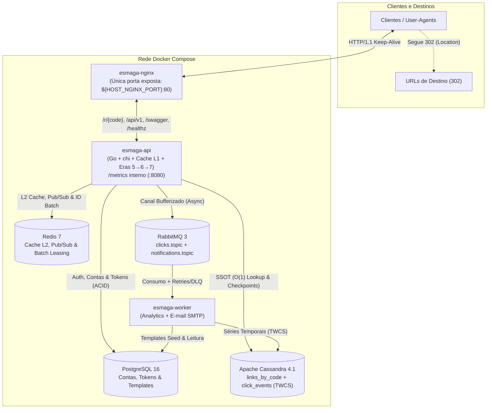

# Esmaga Link: Plataforma de Encurtamento de Alta Vazão e Telemetria


> **Idioma / Language:** **Português (Brasil)** | [Read in English (README_EN.md)](README_EN.md)

O **Esmaga Link** é uma plataforma distribuída de encurtamento de URLs e telemetria analítica projetada para cenários de altíssima concorrência. Construído sob arquitetura orientada a eventos e isolamento estrito de carga (CQRS), o sistema sustenta redirecionamentos de baixa latência ($P99 < 50\text{ms}$).

Seu núcleo abandona geradores aleatórios e travas em banco de dados em favor de uma **bijeção modular determinística** sobre anéis finitos em **eras progressivas ($5 \to 6 \to 7$ caracteres)**: geração local em CPU sem I/O via LCG de período completo (Teorema de Hull-Dobell) e **zero colisões por construção algébrica**.


*Cada frame ilustra um lote de IDs sendo consumido em ordem intra-lote permutada (mecanismo aplicado deliberadamente em cada instância para impedir correlação sequencial), cuja entropia é ainda mais amplificada com múltiplos nós concorrentes. O rastro em amarelo evidencia que os 10 IDs já chegam dispersos ao anel antes mesmo do primeiro acesso, sendo assim a prova visual de que a dispersão espacial independe da ordem de consumo.*

---

## Principais Garantias Arquiteturais

| Propriedade                      | Mecanismo                                                     | Benefício Prático                                         |
| :------------------------------- | :------------------------------------------------------------ | :-------------------------------------------------------- |
| **Zero colisões**                | LCG de período completo (Hull-Dobell) em eras disjuntas       | Elimina `SELECT before INSERT` e retentativas             |
| **Geração local sem I/O**        | Exponenciação rápida $T^n(\text{seed}) \bmod M_k$ em $O(\log n)$ | No máx. 42 iterações (Era 7) com aritmética 128-bit em CPU |
| **Dispersão uniforme**           | Constantes de Hull-Dobell + permutação intra-lote + Base62 embaralhado | Evita enumeração sequencial previsível           |
| **Modo multiplicativo opcional** | $f(x) = (x \cdot P) \bmod M$ com inverso $P^{-1}$ (Euclides Estendido) | Suporte a reversibilidade direta em $O(1)$ quando configurado |
| **APIs *stateless***             | Batch Leasing no Redis + lote embaralhado protegido por `sync.Mutex` | Escala horizontal sem coordenação entre nós         |
| **Hot Path $P99 < 50\text{ms}$** | CQRS + Cache L1/L2 + resposta `302` (`no-store`) sem *body allocation* | Telemetria assíncrona nunca degrada o redirecionamento |
| **Resiliência SSOT**             | Cassandra como fonte única da verdade + `SetNX` + LWT (Paxos) | Recuperação automática contra perda total do Redis        |

---

## Sumário

- [Esmaga Link: Plataforma de Encurtamento de Alta Vazão e Telemetria](#esmaga-link-plataforma-de-encurtamento-de-alta-vazão-e-telemetria)
  - [Principais Garantias Arquiteturais](#principais-garantias-arquiteturais)
  - [Sumário](#sumário)
  - [1. A Decisão Matemática](#1-a-decisão-matemática)
    - [1.1. Por que rejeitamos as abordagens convencionais](#11-por-que-rejeitamos-as-abordagens-convencionais)
    - [1.2. A solução: Eras progressivas e LCG de período completo (Hull-Dobell)](#12-a-solução-eras-progressivas-e-lcg-de-período-completo-hull-dobell)
    - [1.3. Dispersão uniforme e escolha das constantes](#13-dispersão-uniforme-e-escolha-das-constantes)
    - [1.4. Segunda camada: ofuscação lexical](#14-segunda-camada-ofuscação-lexical)
    - [1.5. Reversibilidade e modo multiplicativo alternativo](#15-reversibilidade-e-modo-multiplicativo-alternativo)
    - [1.6. Prova formal de ausência de colisões](#16-prova-formal-de-ausência-de-colisões)
  - [2. Arquitetura de Alto Nível](#2-arquitetura-de-alto-nível)
  - [3. Stack Tecnológico](#3-stack-tecnológico)
  - [4. Operação e Escala](#4-operação-e-escala)
    - [4.1. Isolamento de caminhos (Hot vs. Cold)](#41-isolamento-de-caminhos-hot-vs-cold)
    - [4.2. Batch Leasing](#42-batch-leasing)
    - [4.3. Resiliência e recuperação](#43-resiliência-e-recuperação)
  - [5. Segurança de Borda](#5-segurança-de-borda)
  - [6. Contratos da API HTTP](#6-contratos-da-api-http)
    - [6.1. Criação de shortcodes](#61-criação-de-shortcodes)
    - [6.2. Redirecionamento (Hot Path)](#62-redirecionamento-hot-path)
    - [6.3. Fluxo autenticado via cURL](#63-fluxo-autenticado-via-curl)
  - [7. Testes e Verificação](#7-testes-e-verificação)
  - [8. Como Executar e Operação](#8-como-executar-e-operação)

---

## 1. A Decisão Matemática

Todo encurtador de URLs de alta escala precisa resolver um dilema fundamental: **como gerar códigos curtos e únicos em paralelo, sem coordenação entre nós, sem colisões e sem consultas prévias ao banco?** Abordagens tradicionais sacrificam pelo menos um desses requisitos.

### 1.1. Por que rejeitamos as abordagens convencionais

| Abordagem                | Complexidade | Colisões | Reversível | Ofuscação | Limitação Estrutural                                       |
| :----------------------- | :----------: | :------: | :--------: | :-------: | :--------------------------------------------------------- |
| `AUTO_INCREMENT` central |    $O(1)$    |   Zero   |    Sim     |  Nenhuma  | Ponto único de contenção; quebra o modelo *stateless*      |
| UUID v4                  |    $O(1)$    |   Nula   |    Sim     |  Nenhuma  | 128 bits (longo demais para URLs); fragmentação de índices |
| Hash truncado (MD5/SHA)  |    $O(1)$    | **Sim**  |    Não     |    Boa    | Paradoxo do Aniversário; exige `SELECT before INSERT`      |
| Snowflake                |    $O(1)$    |   Zero   |    Sim     |   Fraca   | Ordenável por timestamp e previsível por inspeção          |
| NanoID / PRNG            |    $O(1)$    | **Sim**  |    Não     |    Boa    | Sem determinismo; exige verificação de unicidade           |

O objetivo era encontrar uma função $f: \mathbb{Z}_{M_k} \to \mathbb{Z}_{M_k}$ que fosse simultaneamente **bijetora** (zero colisões garantidas), **computável diretamente em memória sem estado iterativo** e **geometricamente dispersa** (resistente à enumeração por análise de frequência).

### 1.2. A solução: Eras progressivas e LCG de período completo (Hull-Dobell)

Para entregar códigos curtos desde o início sem desperdiçar espaço nem arriscar colisões ao crescer, o gerador organiza os códigos em **Eras progressivas por comprimento ($5 \to 6 \to 7$ caracteres)**, com preenchimento à esquerda (*padding* pelo primeiro caractere do alfabeto):

- **Era 5 ($62^5$):** `916.132.832` (~916 milhões de códigos com 5 caracteres)
- **Era 6 ($62^6$):** `56.800.235.584` (~56,8 bilhões de códigos com 6 caracteres)
- **Era 7 ($62^7$):** `3.521.614.606.208` (~3,52 trilhões de códigos com 7 caracteres)

Como cada era possui um comprimento fixo distinto, **as eras são estritamente disjuntas por tamanho** — um código de 5 caracteres nunca colide com um de 6 ou 7, permitindo aproveitar **100% de cada universo $M_k = 62^k$** (mais de **3,57 trilhões** de códigos únicos no total).

Dentro de cada era (`DefaultEras()`), a ofuscação utiliza um **LCG (*Linear Congruential Generator*) de período completo** validado pelo **Teorema de Hull-Dobell**, calculado diretamente em tempo $O(\log n)$ por exponenciação binária da transformação afim (sem manter estado iterativo e com aritmética modular de 128 bits via `bits.Mul64`/`bits.Div64` para evitar *overflow*):

$$\text{ID}_{\text{ofuscado}} = T^n(\text{seed}) \pmod{M_k}, \quad T(x) = (A \cdot x + C) \bmod M_k$$

Onde:
- $n$ é o índice local do `seqID` dentro da era atual (alocado em lote no Redis e permutado em memória).
- Como $M_k = 62^k = 2^k \cdot 31^k$, $A$ e $C$ são validados na inicialização contra as 3 condições de Hull-Dobell:
  1. $\gcd(C, M_k) = 1$;
  2. $(A - 1)$ é divisível por todos os fatores primos de $M_k$ ($2$ e $31$);
  3. $4 \mid (A - 1)$ (pois $4 \mid M_k$ para $k \ge 2$).

Essas condições garantem que a sequência percorra um **ciclo Hamiltoniano completo** de comprimento exato $M_k$, visitando cada inteiro em $[0, M_k - 1]$ exatamente uma vez antes de repetir.

### 1.3. Dispersão uniforme e escolha das constantes

Em cada era, as constantes $(A, C)$ são escolhidas para maximizar a dispersão espacial sobre o anel $\mathbb{Z}_{M_k}$ sem agrupamentos previsíveis (com $A_5 / M_5 \approx \phi^{-1}$ e $A_7 / M_7 \approx \phi^{-1}$, onde $\phi^{-1} = \frac{\sqrt{5}-1}{2} \approx 0{,}6180339887$, e constantes derivadas de $\pi$, $e$ e $\sqrt{2}$ ajustadas às restrições de Hull-Dobell):

| Era   | Universo ($M_k = 62^k$) | Multiplicador ($A$)   | Incremento ($C$)      |
| :---- | :---------------------: | :-------------------: | :-------------------: |
| Era 5 | `916.132.832`           | `566.165.401`         | `271.828.183`         |
| Era 6 | `56.800.235.584`        | `3.141.592.701`       | `2.718.281.829`       |
| Era 7 | `3.521.614.606.208`     | `2.176.510.000.001`   | `1.414.213.562.373`   |

Assim, incrementos unitários fragmentam o espaço lógico de forma quase uniforme, emulando a aparência de aleatoriedade, mas preservando **determinismo, período completo e zero colisões**.

### 1.4. Segunda camada: ofuscação lexical

Converter inteiros usando alfabetos ordenados (`0123...XYZ`) expõe padrões triviais nos dígitos mais significativos. Para eliminar essa assinatura, o dicionário Base62 passa por um embaralhamento **Fisher-Yates** determinístico no boot da aplicação a partir da variável de ambiente `ALPHABET_SEED` (hash `FNV-1a 64-bit` alimentando o PRNG):

- **Alfabeto Base62 padrão:** `0123456789abcdefghijklmnopqrstuvwxyzABCDEFGHIJKLMNOPQRSTUVWXYZ`
- **Exemplo de alfabeto permutado:** `zWv6UYRb9tIGpKVrc2EFw1lTHemsSjqC5a03DL7Z4QPBdJyNhiouAMXgfxn8Ok`

A combinação da bijeção modular com o alfabeto permutado impede a predição da sequência sem o conhecimento simultâneo das constantes da era e da `ALPHABET_SEED`.

### 1.5. Reversibilidade e modo multiplicativo alternativo

O motor `EraConfig` suporta dois modos bijetores sobre $\mathbb{Z}_M$:

1. **Modo padrão (LCG Hull-Dobell, `Increment > 0`):** utilizado em produção por `DefaultEras()`. Cada transição $T(x) = (A x + C) \bmod M$ é bijetora e reversível passo a passo via $T^{-1}(y) = (y - C) \cdot A^{-1} \bmod M$, enquanto recuperar o índice sequencial $n$ a partir de $T^n(\text{seed})$ equivale a um problema de logaritmo discreto no grupo afim — oferecendo uma camada adicional contra inferência de volume.
2. **Modo multiplicativo puro (`Increment == 0`):** suportado opcionalmente por `EraConfig` com multiplicador coprimo $P \approx M \cdot \phi^{-1}$ (`FindGoldenCoprime`). Pela Identidade de Bézout, $\gcd(P, M) = 1$ garante um único inverso multiplicativo modular $P^{-1}$ via Algoritmo Euclidiano Estendido (`ModularInverse`), permitindo reversão direta em $O(1)$:

$$(P \cdot P^{-1}) \equiv 1 \pmod M \implies \text{ID}_{\text{seq}} = (\text{ID}_{\text{ofuscado}} \cdot P^{-1}) \pmod M$$

### 1.6. Prova formal de ausência de colisões

**Caso 1 — LCG de período completo (modo padrão em produção).** Pelo **Teorema de Hull-Dobell**, a recorrência $x_{n+1} = (A x_n + C) \bmod M_k$ tem período exato $M_k$ se, e somente se, $\gcd(C, M_k)=1$, todo primo $p \mid M_k$ divide $(A-1)$, e $4 \mid M_k \implies 4 \mid (A-1)$. Como o domínio $[0, M_k - 1]$ possui exatamente $M_k$ elementos e a órbita a partir de `seed` tem comprimento $M_k$, a função $n \mapsto T^n(\text{seed}) \bmod M_k$ é necessariamente **injetora e sobrejetora (bijetora)** em $[0, M_k - 1]$.

**Caso 2 — Multiplicação modular coprima (modo alternativo).** A função $f(x) = (x \cdot P) \bmod M$ é estritamente bijetora se, e somente se, $\gcd(P, M) = 1$.

*Prova.* Suponha, por absurdo, que existam $x_1 \neq x_2$ com $x_1, x_2 \in [0, M-1]$ tais que $f(x_1) = f(x_2)$:

$$(x_1 \cdot P) \equiv (x_2 \cdot P) \pmod M \implies M \mid P(x_1 - x_2)$$

Aplicando o Lema de Euclides com $\gcd(P, M) = 1$, segue que $M \mid (x_1 - x_2)$. Como $\vert{}x_1 - x_2\vert{} < M$, o único múltiplo de $M$ nesse intervalo é $0$, implicando $x_1 = x_2$ — contradição. $\blacksquare$

**Consequências para a engenharia:**
- **Zero locks distribuídos:** cada instância Go computa o código localmente sem consultar outros nós.
- **Zero rondas de verificação:** não há `SELECT` prévio para checar existência de código antes da escrita.
- **Unicidade intrínseca:** a ausência de colisão é garantida pela álgebra do anel e pela disjunção entre eras, não por índices únicos sob contenção.

---

## 2. Arquitetura de Alto Nível

A topologia aplica **CQRS** (*Command and Query Responsibility Segregation*) para isolar completamente o caminho crítico de redirecionamento HTTP (*Hot Path*) do pipeline assíncrono de telemetria (*Cold Path*).



**Pilares da topologia:**
1. **Nós Go *stateless*:** qualquer instância atende escrita ou leitura sem afinidade de sessão.
2. **Cassandra como SSOT (*Single Source of Truth*):** armazenamento *masterless* com leitura determinística em $O(1)$ via *partition key* `short_code`.
3. **Redis como acelerador volátil:** opera como cache L2, barramento Pub/Sub de invalidação L1, coordenador de blocos de IDs e contador de rate limit.
4. **RabbitMQ como amortecedor de carga:** absorve surtos de cliques e disparos transacionais de e-mail sem propagar *backpressure* ao redirecionamento.

---

## 3. Stack Tecnológico

A persistência segue o modelo **poliglota**, alocando cada domínio ao motor com as melhores garantias CAP para seu padrão de acesso:

| Componente               | Domínio                           | Justificativa Técnica                                                                                                                                                                                                       |
| :----------------------- | :-------------------------------- | :-------------------------------------------------------------------------------------------------------------------------------------------------------------------------------------------------------------------------- |
| **Redis 7**              | Cache L2, Pub/Sub e Batch Leasing | Operações atômicas em memória (`INCRBY`, `SETNX`, `GET`, `SET`) eliminam contenção na alocação de faixas de IDs, mantêm leituras quentes em $\sim 1\text{ms}$ e sincronizam invalidação do cache L1 via Pub/Sub (`esmaga:cache:invalidate`). |
| **Apache Cassandra 4.1** | Catálogo de URLs e Telemetria     | Arquitetura *wide-column* e *masterless*. `links_by_code` particiona por `short_code` para leitura $O(1)$; `click_events` particiona por `(short_code, bucket_date)` com **TWCS** (*TimeWindowCompactionStrategy*, janela de 1 dia) para séries temporais. |
| **PostgreSQL 16**        | Usuários, Tokens e Templates      | Consistência ACID estrita para contas, verificação de e-mail (`auth_tokens`), rotação de sessões (`refresh_tokens`) e templates transacionais (`email_templates` semeados no boot). |
| **RabbitMQ 3**           | Barramento Analítico e E-mail     | Mensageria AMQP com `clicks.topic` para telemetria e `notifications.topic` com filas dedicadas de retry escalonado (`10s / 1m / 5m`, sem *head-of-line blocking*) + `notifications.email.dlq` para envio SMTP assíncrono agnóstico de provedor. |

---

## 4. Operação e Escala

### 4.1. Isolamento de caminhos (Hot vs. Cold)

Sistemas monolíticos degradam quando a escrita de telemetria (IP, *User-Agent*, *Referer*) disputa conexões e IOPS com a resolução de URLs. O Esmaga Link separa esses fluxos:

**Caminho Quente (Redirecionamento com $P99 < 50\text{ms}$):**
1. O Nginx encaminha a requisição para a API reutilizando conexões HTTP Keep-Alive; a rota `/r/{code}` opera isolada sem *middlewares* pesados (sem `Logger` síncrono nem CORS).
2. A API consulta primeiro o **cache L1 em memória** (`TTL = 30s`, até `50.000` entradas) e, em caso de *miss*, consulta o **cache L2 (Redis)** (`TTL = 24h`) com pool de conexões pré-aquecido (`PoolSize = 64`).
3. Em *cache miss* no Redis, consulta o Cassandra por *partition key* (`LocalOne`), popula o L1, dispara o aquecimento do Redis em *background* e responde `302 Found` apenas via headers (`Location` e `Cache-Control: no-store`) sem corpo HTTP (*zero body allocation*).
4. Em paralelo, enfileira o evento de clique em um canal bufferizado (`4096`) consumido por goroutine dedicada para publicação no RabbitMQ de forma **não bloqueante**.

**Caminho Frio (Ingestão Analítica, Notificações & Invalidação):**
1. *Workers* dedicados em Go consomem `clicks.topic` (gravando eventos de clique no Cassandra com TWCS) e `notifications.topic` (renderizando templates do PostgreSQL e disparando e-mails via SMTP com filas de retry escalonado e DLQ).
2. Ao editar (`PUT`) ou desativar (`DELETE`) um link, a API atualiza o Cassandra, remove a chave no Redis e publica o `short_code` no canal Pub/Sub `esmaga:cache:invalidate` para invalidar imediatamente o cache L1 de todas as réplicas.

### 4.2. Batch Leasing

Para evitar o gargalo de incrementos remotos a cada requisição, as instâncias Go alugam faixas contínuas de sequências:

1. A instância solicita um bloco ao Redis: `INCRBY esmaga:counter:id_sequence 1000`.
2. O processo assume posse exclusiva do intervalo local $[53001, 54000]$ e embaralha o lote em memória com `math/rand/v2.Shuffle`.
3. *Goroutines* concorrentes consomem o próximo índice do lote embaralhado em nanossegundos sob `sync.Mutex`, sem tráfego de rede.

Com `ID_BATCH_SIZE = 1000`, o custo amortizado de coordenação cai para **$0{,}001$ RTT por ID**, permanecendo desprezível mesmo a $10^5\text{ req/s}$.

> **Permutação intra-lote como camada de defesa:** mesmo operando com uma única instância, os IDs de um bloco alugado são consumidos em ordem permutada. Esse embaralhamento local impede que um atacante infira sequências contíguas a partir de requisições próximas no tempo; em topologias com múltiplas instâncias concorrentes, a aleatoriedade observada externamente torna-se ainda maior. Como demonstrado no GIF de abertura, a bijeção modular preserva a dispersão uniforme no anel independentemente da ordem de consumo.

### 4.3. Resiliência e recuperação

Por ser armazenado em memória, o Redis é tratado como componente descartável. Em caso de perda total de estado (reinicialização sem persistência ou falha de nó), a integridade é restaurada automaticamente a partir do Cassandra:

1. **Checkpoints duráveis:** a cada reserva de lote, o *High-Water Mark* é registrado na tabela `esmaga_link.id_checkpoints`.
2. **Auto-recuperação no boot:** caso a chave `esmaga:counter:id_sequence` não exista no Redis durante a inicialização, a API lê o último checkpoint no Cassandra, soma uma margem de segurança $\Delta = 2 \times \text{BatchSize}$ e reinicializa o contador de forma atômica via `SETNX`, impedindo regressão, sobreposição ou corrida entre réplicas iniciando juntas.
3. **Barreira final via LWT (Paxos):** toda criação de link executa `INSERT INTO links_by_code ... IF NOT EXISTS` (`MapScanCAS`). Se uma anomalia tentar reutilizar um código ativo, o Cassandra rejeita a escrita (`applied: false`) e a API descarta o ID, avançando imediatamente para a próxima sequência (até 3 tentativas).

---

## 5. Segurança de Borda

- **Proteção contra SSRF:** toda URL submetida passa por *parsing* estrito e resolução DNS antes da persistência. Endereços apontando para redes privadas (RFC 1918), CGNAT (`100.64.0.0/10`), *loopback* (`127.0.0.0/8`, `::1`), IPv6 link-local/ULA (`fe80::/10`, `fc00::/7`) ou endpoints de metadados de nuvem (`169.254.169.254`, `metadata.google.internal`) são bloqueados na borda.
- **Rate Limiting distribuído:** algoritmo *Fixed Window Counter* executado via `Pipeline` (`INCR` + `EXPIRE`) no Redis, por IP ou `user:{id}` autenticado (`auth`: `20 req/min`, `create_link`: `30 req/min`, `resend_verification`: `1 req/min`), com modo *fail-open* caso o Redis fique indisponível.
- **Autenticação JWT + Refresh Token (`HMAC-SHA256`):** *access tokens* curtos (`15min`) combinados com *refresh tokens* rotacionáveis (`30d`, hash SHA-256 em banco + cookie `HttpOnly`). Contas não verificadas não podem autenticar nem editar/desativar links.
- **Anti-Bot (Cloudflare Turnstile):** validação server-side opcional via `siteverify` (ativada quando `TURNSTILE_SITE_KEY` e `TURNSTILE_SECRET_KEY` são configurados) com verificação de `action` por superfície (`create_link` na criação anônima de links, `register` no cadastro e `forgot_password` na recuperação de senha) e allowlist de domínios em `TURNSTILE_HOSTNAMES` (*fail-closed* se vazia; nunca inclua `localhost`/`127.0.0.1` em produção). Tokens inválidos, expirados ou reutilizados são rejeitados com `403 Forbidden`, e o frontend mantém instâncias independentes com reset automático por formulário.
- **Cabeçalhos de segurança no Nginx:** `Content-Security-Policy` estrita (`frame-ancestors 'none'`), `X-Frame-Options: DENY`, `X-Content-Type-Options: nosniff` e `Referrer-Policy: strict-origin-when-cross-origin`.

---

## 6. Contratos da API HTTP

| Método   | Endpoint                              |  Autenticação  | Descrição                                                                 |
| :------- | :------------------------------------ | :------------: | :------------------------------------------------------------------------ |
| `GET`    | `/swagger/index.html`                 |    Pública     | Documentação interativa Swagger UI (`swaggo`)                             |
| `GET`    | `/healthz`                            |    Pública     | Health check da instância da API                                          |
| `GET`    | `/metrics` *(interno `:8080`)*        |    Interna     | Métricas Prometheus (`text/plain; version=0.0.4`), não exposto no Nginx   |
| `GET`    | `/api/v1/config`                      |    Pública     | Configurações públicas de borda (`turnstile_site_key`, `portfolio_mode`)  |
| `POST`   | `/api/v1/auth/register`               |    Pública     | Cadastra conta `pending` e enfileira e-mail de verificação                |
| `POST`   | `/api/v1/auth/verify-email`           |    Pública     | Valida token de uso único (24h) e ativa a conta                           |
| `POST`   | `/api/v1/auth/resend-verification`    |    Pública     | Reenvia e-mail de confirmação (rate limit `1 req/min`)                    |
| `POST`   | `/api/v1/auth/login`                  |    Pública     | Autentica usuário verificado e emite `access_token` + `refresh_token`     |
| `POST`   | `/api/v1/auth/refresh`                |    Pública     | Rotaciona o par `access_token` / `refresh_token`                          |
| `POST`   | `/api/v1/auth/logout`                 |    Pública     | Revoga o `refresh_token` atual e limpa o cookie                           |
| `POST`   | `/api/v1/auth/forgot-password`        |    Pública     | Sempre retorna `200 OK`; se o e-mail existir, envia token de reset (30m)  |
| `POST`   | `/api/v1/auth/reset-password`         |    Pública     | Atualiza senha via token e revoga todos os `refresh_tokens` ativos        |
| `GET`    | `/api/v1/auth/me`                     |      JWT       | Retorna perfil da conta autenticada                                       |
| `PATCH`  | `/api/v1/auth/me`                     |      JWT       | Atualiza nome e/ou senha (exigindo `current_password`)                    |
| `DELETE` | `/api/v1/auth/account`                |      JWT       | Exclui a conta (opção `keep_links_active`) e notifica por e-mail          |
| `POST`   | `/api/v1/links`                       | Opcional / JWT | Encurta uma nova URL e retorna o `short_code`                             |
| `GET`    | `/api/v1/links`                       |      JWT       | Lista os links do usuário autenticado                                     |
| `GET`    | `/api/v1/links/{code}/stats`          |      JWT       | Retorna analytics agregados (`days` de `1` a `90`)                        |
| `PUT`    | `/api/v1/links/{code}`                |      JWT       | Atualiza a URL original de um link e invalida L1/L2                       |
| `DELETE` | `/api/v1/links/{code}`                |      JWT       | Desativa o link (`is_active = false`) e invalida L1/L2                    |
| `GET`    | `/r/{short_code}`                     |    Pública     | Redireciona (`302 Found`) para a URL original                             |

### 6.1. Criação de shortcodes

```http
POST /api/v1/links
Content-Type: application/json
```

```json
{
  "original_url": "https://www.dominio-longo-exemplo.com/artigo-tecnico"
}
```

**Resposta (`201 Created`):**

```json
{
  "short_code": "CjINS",
  "original_url": "https://www.dominio-longo-exemplo.com/artigo-tecnico",
  "is_active": true,
  "created_at": "2026-11-08T14:32:30.849Z"
}
```

### 6.2. Redirecionamento (Hot Path)

```http
GET /r/{short_code}
```

**Resposta (`302 Found` — sem body):**

```http
HTTP/1.1 302 Found
Location: https://www.dominio-longo-exemplo.com/artigo-tecnico
Cache-Control: no-store
```

### 6.3. Fluxo autenticado via cURL

```bash
# 1. Obter access_token (após confirmar e-mail)
JWT_TOKEN=$(curl -s -X POST http://localhost/api/v1/auth/login \
  -H "Content-Type: application/json" \
  -d '{"email":"admin@empresa.com","password":"StrongPassword123!"}' | jq -r '.access_token')

# 2. Criar link autenticado
curl -s -X POST http://localhost/api/v1/links \
  -H "Authorization: Bearer $JWT_TOKEN" \
  -H "Content-Type: application/json" \
  -d '{"original_url":"https://empresa.com/campanha-v1"}'
```

---

## 7. Testes e Verificação

As invariantes matemáticas (Hull-Dobell, coprimalidade, bijeção, progressão de eras, `lcgNth` vs. iterativo e embaralhamento lexical) e a segurança contra concorrência são verificadas por suítes determinísticas:

```bash
# Testes de axiomas matemáticos e ausência de colisões com detector de race conditions
go test -v ./internal/idgen/... -race -count=1

# Suíte completa com relatório de cobertura
go test -v ./... -race -coverprofile=coverage.out
```

---

## 8. Como Executar e Operação

**Pré-requisitos:** Docker Engine 24.0+ e Docker Compose v2.20+ (Go 1.26+ opcional para execução local dos testes).

```bash
# 1. Configurar variáveis de ambiente (todas as variáveis do Compose vêm do .env)
cp .env.example .env
# Edite o .env preenchendo JWT_SECRET, ALPHABET_SEED e as credenciais SMTP (SMTP_HOST/PORT/FROM)
# Opcional (Turnstile): preencha TURNSTILE_SITE_KEY, TURNSTILE_SECRET_KEY e TURNSTILE_HOSTNAMES (deixe vazios em dev para desabilitar)

# 2. Subir toda a stack a partir da raiz (Nginx, Go API, Cassandra, Redis, PostgreSQL, RabbitMQ e Worker)
docker compose up -d --build
```

Apenas o **Nginx** fica exposto para o host (porta configurada em `HOST_NGINX_PORT`). Os *entrypoints* inicializam o schema DDL no PostgreSQL, criam os *keyspaces*/tabelas no Cassandra (`cassandra-init`, incluindo `click_events` com TWCS), semeiam os templates de e-mail padrão no boot do `worker` e sobem os consumidores de analytics e notificações.

- **Interface Web (Frontend):** `http://localhost/` (encurtador, dashboard autenticado, verificação de e-mail e redefinição de senha; com `PORTFOLIO_MODE=true`, habilita também `/engenharia` e o atalho do Swagger)
- **Swagger UI:** `http://localhost/swagger/index.html`
- **Métricas Prometheus (rede interna):** `http://api:8080/metrics` (exposta apenas internamente no container `esmaga-api`, fora do proxy público Nginx)
- **Logs estruturados:** saída colorida no estilo *zerolog* (`log/slog`) com `request_id`, `service` e `instance`.
- **Backup automatizado:** execute [deployments/scripts/backup.sh](deployments/scripts/backup.sh) via `cron` para `pg_dump` compactado (retenção configurável via `BACKUP_RETENTION_DAYS`) e `nodetool snapshot` no Cassandra.

**Verificação rápida:**

```bash
curl -i -X POST http://localhost/api/v1/links \
  -H "Content-Type: application/json" \
  -d '{"original_url":"https://github.com"}'
```
