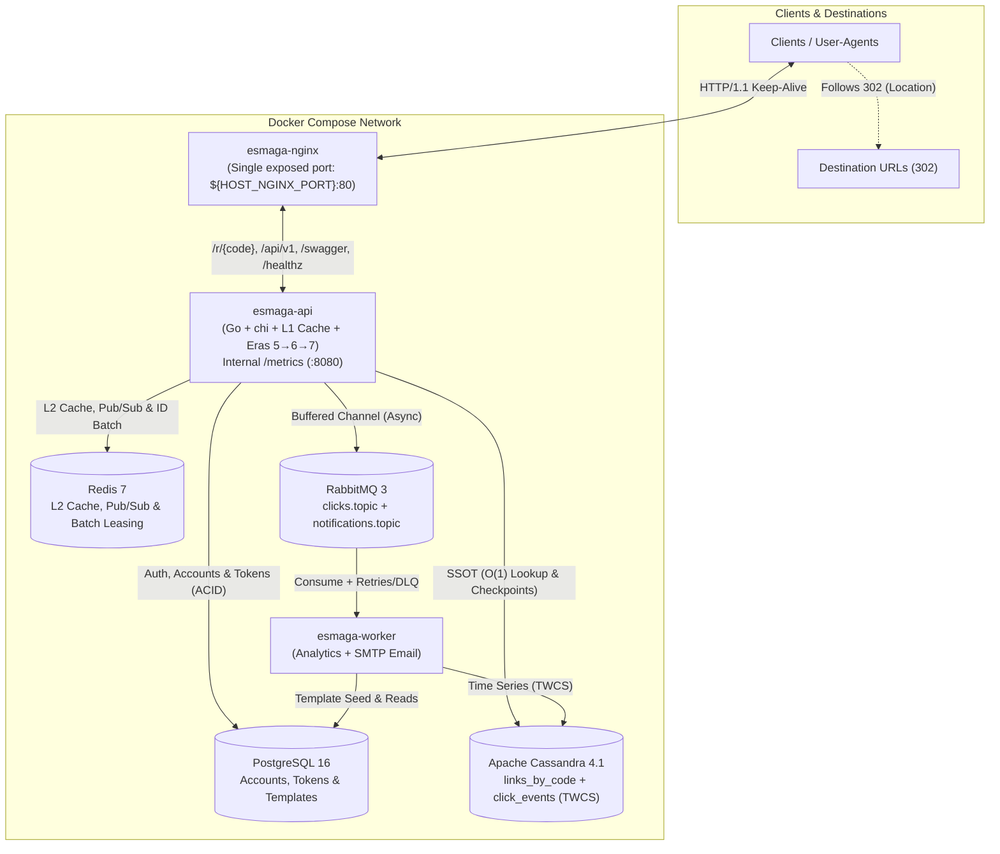

# Esmaga Link: High-Throughput URL Shortening and Telemetry Platform


> **Language / Idioma:** **English** | [Leia em Português (README.md)](README.md)

**Esmaga Link** is a distributed URL shortening and analytical telemetry platform engineered for ultra-high concurrency scenarios. Built on an event-driven architecture with strict workload isolation (CQRS), the system sustains low-latency redirects ($P99 < 50\text{ms}$).

At its core, it abandons random generators and database locks in favor of a **deterministic modular bijection** over finite rings across **progressive eras ($5 \to 6 \to 7$ characters)**: local CPU generation with zero I/O via a full-period LCG (Hull-Dobell Theorem) and **zero collisions by algebraic construction**.


*Each frame illustrates a batch of IDs being consumed in an intra-batch permuted order (a mechanism deliberately applied on every instance to prevent sequential correlation), whose entropy is further amplified across multiple concurrent nodes. The yellow trail demonstrates that all 10 IDs already land dispersed across the ring prior to the first access, serving as visual proof that spatial dispersion is independent of consumption order.*

---

## Key Architectural Guarantees

| Property                          | Mechanism                                                      | Practical Benefit                                              |
| :-------------------------------- | :------------------------------------------------------------- | :------------------------------------------------------------- |
| **Zero collisions**               | Full-period LCG (Hull-Dobell) across disjoint length-based eras | Eliminates `SELECT before INSERT` and retry loops             |
| **Local zero-I/O generation**     | Fast exponentiation $T^n(\text{seed}) \bmod M_k$ in $O(\log n)$ | At most 42 steps (Era 7) using 128-bit CPU arithmetic         |
| **Uniform dispersion**            | Hull-Dobell constants + intra-batch shuffle + shuffled Base62  | Prevents predictable sequential enumeration                    |
| **Optional multiplicative mode**  | $f(x) = (x \cdot P) \bmod M$ with $P^{-1}$ (Extended Euclidean) | Supports direct $O(1)$ reversibility when configured          |
| ***Stateless* APIs**              | Redis Batch Leasing + shuffled batch guarded by `sync.Mutex`   | Horizontal scaling with zero inter-node coordination           |
| **Hot Path $P99 < 50\text{ms}$**  | CQRS + L1/L2 Cache + zero-allocation `302` (`no-store`)        | Asynchronous telemetry never degrades redirect latency         |
| **SSOT resilience**               | Cassandra as Single Source of Truth + `SetNX` + LWT (Paxos)    | Automatic recovery against total Redis state loss              |

---

## Table of Contents

- [Esmaga Link: High-Throughput URL Shortening and Telemetry Platform](#esmaga-link-high-throughput-url-shortening-and-telemetry-platform)
  - [Key Architectural Guarantees](#key-architectural-guarantees)
  - [Table of Contents](#table-of-contents)
  - [1. The Mathematical Decision](#1-the-mathematical-decision)
    - [1.1. Why We Rejected Conventional Approaches](#11-why-we-rejected-conventional-approaches)
    - [1.2. The Solution: Progressive Eras and Full-Period LCG (Hull-Dobell)](#12-the-solution-progressive-eras-and-full-period-lcg-hull-dobell)
    - [1.3. Uniform Dispersion and Constant Selection](#13-uniform-dispersion-and-constant-selection)
    - [1.4. Second Layer: Lexical Obfuscation](#14-second-layer-lexical-obfuscation)
    - [1.5. Reversibility and Optional Multiplicative Mode](#15-reversibility-and-optional-multiplicative-mode)
    - [1.6. Formal Proof of Collision Absence](#16-formal-proof-of-collision-absence)
  - [2. High-Level Architecture](#2-high-level-architecture)
  - [3. Technology Stack](#3-technology-stack)
  - [4. Operations and Scale](#4-operations-and-scale)
    - [4.1. Path Isolation (Hot vs. Cold)](#41-path-isolation-hot-vs-cold)
    - [4.2. Batch Leasing](#42-batch-leasing)
    - [4.3. Resilience and Recovery](#43-resilience-and-recovery)
  - [5. Edge Security](#5-edge-security)
  - [6. HTTP API Contracts](#6-http-api-contracts)
    - [6.1. Creating Shortcodes](#61-creating-shortcodes)
    - [6.2. Redirection (Hot Path)](#62-redirection-hot-path)
    - [6.3. Authenticated Flow via cURL](#63-authenticated-flow-via-curl)
  - [7. Testing and Verification](#7-testing-and-verification)
  - [8. How to Run and Operations](#8-how-to-run-and-operations)

---

## 1. The Mathematical Decision

Every high-scale URL shortener must solve a fundamental dilemma: **how to generate short, unique codes in parallel, without inter-node coordination, without collisions, and without prior database queries?** Traditional approaches sacrifice at least one of these requirements.

### 1.1. Why We Rejected Conventional Approaches

| Approach                 | Complexity | Collisions | Reversible | Obfuscation | Structural Limitation                                    |
| :----------------------- | :--------: | :--------: | :--------: | :---------: | :------------------------------------------------------- |
| Central `AUTO_INCREMENT` |   $O(1)$   |    Zero    |    Yes     |    None     | Single point of contention; breaks *stateless* design    |
| UUID v4                  |   $O(1)$   | Negligible |    Yes     |    None     | 128 bits (too long for URLs); index fragmentation        |
| Truncated Hash (MD5/SHA) |   $O(1)$   |  **Yes**   |     No     |    Good     | Birthday Paradox; requires `SELECT before INSERT`        |
| Snowflake                |   $O(1)$   |    Zero    |    Yes     |    Weak     | Timestamp-sortable and predictable upon inspection       |
| NanoID / PRNG            |   $O(1)$   |  **Yes**   |     No     |    Good     | Non-deterministic; requires uniqueness verification      |

The goal was to find a function $f: \mathbb{Z}_{M_k} \to \mathbb{Z}_{M_k}$ that is simultaneously **bijective** (guaranteed zero collisions), **directly computable in memory without iterative state**, and **geometrically dispersed** (resistant to enumeration via frequency analysis).

### 1.2. The Solution: Progressive Eras and Full-Period LCG (Hull-Dobell)

To deliver short codes from day one without wasting address space or risking collisions as the system grows, the generator organizes codes into **progressive length-based Eras ($5 \to 6 \to 7$ characters)**, left-padded with the first character of the alphabet:

- **Era 5 ($62^5$):** `916,132,832` (~916 million 5-character codes)
- **Era 6 ($62^6$):** `56,800,235,584` (~56.8 billion 6-character codes)
- **Era 7 ($62^7$):** `3,521,614,606,208` (~3.52 trillion 7-character codes)

Because each era enforces a distinct fixed length, **eras are strictly disjoint by size**—a 5-character code can never collide with a 6- or 7-character code, allowing **100% utilization of every $M_k = 62^k$ universe** (over **3.57 trillion** unique codes in total).

Within each era (`DefaultEras()`), obfuscation uses a **full-period LCG (*Linear Congruential Generator*)** validated by the **Hull-Dobell Theorem**, evaluated directly in $O(\log n)$ time via binary exponentiation of the affine map (without iterative state, using 128-bit modular arithmetic via `bits.Mul64`/`bits.Div64` to prevent `uint64` overflow):

$$\text{ID}_{\text{obfuscated}} = T^n(\text{seed}) \pmod{M_k}, \quad T(x) = (A \cdot x + C) \bmod M_k$$

Where:
- $n$ is the local index of `seqID` within the current era (leased in batches from Redis and permuted in memory).
- Since $M_k = 62^k = 2^k \cdot 31^k$, $A$ and $C$ are validated at startup against all three Hull-Dobell conditions:
  1. $\gcd(C, M_k) = 1$;
  2. $(A - 1)$ is divisible by all prime factors of $M_k$ ($2$ and $31$);
  3. $4 \mid (A - 1)$ (since $4 \mid M_k$ for $k \ge 2$).

These conditions guarantee a **complete Hamiltonian cycle** of exact length $M_k$, visiting every integer in $[0, M_k - 1]$ exactly once before repeating.

### 1.3. Uniform Dispersion and Constant Selection

Within each era, the constants $(A, C)$ are chosen to maximize spatial dispersion across the $\mathbb{Z}_{M_k}$ ring without predictable clustering (with $A_5 / M_5 \approx \phi^{-1}$ and $A_7 / M_7 \approx \phi^{-1}$, where $\phi^{-1} = \frac{\sqrt{5}-1}{2} \approx 0.6180339887$, alongside constants derived from $\pi$, $e$, and $\sqrt{2}$ adjusted to the Hull-Dobell constraints):

| Era   | Universe ($M_k = 62^k$) | Multiplier ($A$)      | Increment ($C$)       |
| :---- | :---------------------: | :-------------------: | :-------------------: |
| Era 5 | `916,132,832`           | `566,165,401`         | `271,828,183`         |
| Era 6 | `56,800,235,584`        | `3,141,592,701`       | `2,718,281,829`       |
| Era 7 | `3,521,614,606,208`     | `2,176,510,000,001`   | `1,414,213,562,373`   |

Consequently, unit increments fragment the logical space almost uniformly, emulating the appearance of randomness while preserving **determinism, full period, and zero collisions**.

### 1.4. Second Layer: Lexical Obfuscation

Encoding integers with ordered alphabets (`0123...XYZ`) exposes trivial patterns in the most significant digits. To eliminate this signature, the Base62 dictionary undergoes a deterministic **Fisher-Yates** shuffle at application startup seeded from the `ALPHABET_SEED` environment variable (`FNV-1a 64-bit` hash feeding the PRNG):

- **Standard Base62 alphabet:** `0123456789abcdefghijklmnopqrstuvwxyzABCDEFGHIJKLMNOPQRSTUVWXYZ`
- **Example permuted alphabet:** `zWv6UYRb9tIGpKVrc2EFw1lTHemsSjqC5a03DL7Z4QPBdJyNhiouAMXgfxn8Ok`

Combining modular bijection with a permuted alphabet prevents sequence prediction without simultaneous knowledge of the era constants and `ALPHABET_SEED`.

### 1.5. Reversibility and Optional Multiplicative Mode

The `EraConfig` engine supports two bijective modes over $\mathbb{Z}_M$:

1. **Default mode (Hull-Dobell LCG, `Increment > 0`):** used in production by `DefaultEras()`. Each step $T(x) = (A x + C) \bmod M$ is bijective and step-reversible via $T^{-1}(y) = (y - C) \cdot A^{-1} \bmod M$, whereas recovering the sequence index $n$ from $T^n(\text{seed})$ reduces to a discrete logarithm problem in the affine group—providing an extra barrier against volume inference.
2. **Pure multiplicative mode (`Increment == 0`):** optionally supported by `EraConfig` with a coprime multiplier $P \approx M \cdot \phi^{-1}$ (`FindGoldenCoprime`). By Bézout's Identity, $\gcd(P, M) = 1$ guarantees a unique modular multiplicative inverse $P^{-1}$ via the Extended Euclidean Algorithm (`ModularInverse`), enabling direct $O(1)$ reversal:

$$(P \cdot P^{-1}) \equiv 1 \pmod M \implies \text{ID}_{\text{seq}} = (\text{ID}_{\text{obfuscated}} \cdot P^{-1}) \pmod M$$

### 1.6. Formal Proof of Collision Absence

**Case 1 — Full-period LCG (default production mode).** By the **Hull-Dobell Theorem**, the recurrence $x_{n+1} = (A x_n + C) \bmod M_k$ has exact period $M_k$ if, and only if, $\gcd(C, M_k)=1$, every prime $p \mid M_k$ divides $(A-1)$, and $4 \mid M_k \implies 4 \mid (A-1)$. Since the domain $[0, M_k - 1]$ has exactly $M_k$ elements and the orbit starting from `seed` has length $M_k$, the mapping $n \mapsto T^n(\text{seed}) \bmod M_k$ is necessarily **injective and surjective (bijective)** on $[0, M_k - 1]$.

**Case 2 — Coprime modular multiplication (optional mode).** The function $f(x) = (x \cdot P) \bmod M$ is strictly bijective if, and only if, $\gcd(P, M) = 1$.

*Proof.* Suppose, for the sake of contradiction, that there exist $x_1 \neq x_2$ with $x_1, x_2 \in [0, M-1]$ such that $f(x_1) = f(x_2)$:

$$(x_1 \cdot P) \equiv (x_2 \cdot P) \pmod M \implies M \mid P(x_1 - x_2)$$

Applying Euclid's Lemma with $\gcd(P, M) = 1$ yields $M \mid (x_1 - x_2)$. Since $\vert{}x_1 - x_2\vert{} < M$, the only multiple of $M$ within this interval is $0$, implying $x_1 = x_2$—a contradiction. $\blacksquare$

**Engineering consequences:**
- **Zero distributed locks:** every Go instance computes the shortcode locally without querying peer nodes.
- **Zero verification round-trips:** no prior `SELECT` is needed to check code existence before insertion.
- **Intrinsic uniqueness:** collision freedom is enforced by ring algebra and disjoint eras rather than contended unique indexes.

---

## 2. High-Level Architecture

The topology applies **CQRS** (*Command and Query Responsibility Segregation*) to completely isolate the critical HTTP redirection path (*Hot Path*) from the asynchronous telemetry pipeline (*Cold Path*).



**Architectural pillars:**
1. ***Stateless* Go nodes:** any instance handles reads or writes with zero session affinity.
2. **Cassandra as SSOT (*Single Source of Truth*):** *masterless* storage with deterministic $O(1)$ reads via the `short_code` partition key.
3. **Redis as a volatile accelerator:** operates as an L2 cache, L1 invalidation Pub/Sub bus, ID-block lease coordinator, and rate-limit counter.
4. **RabbitMQ as a load buffer:** absorbs click bursts and transactional email delivery without propagating *backpressure* to redirects.

---

## 3. Technology Stack

Persistence follows a **polyglot** model, mapping each domain to the engine offering the best CAP guarantees for its access pattern:

| Component                | Domain                            | Technical Rationale                                                                                                                                                                                                    |
| :----------------------- | :-------------------------------- | :--------------------------------------------------------------------------------------------------------------------------------------------------------------------------------------------------------------------- |
| **Redis 7**              | L2 Cache, Pub/Sub & Batch Leasing | In-memory atomic operations (`INCRBY`, `SETNX`, `GET`, `SET`) eliminate contention during ID range allocation, keep warm reads around $\sim 1\text{ms}$, and synchronize L1 cache invalidation via Pub/Sub (`esmaga:cache:invalidate`). |
| **Apache Cassandra 4.1** | URL Catalog & Telemetry           | *Wide-column*, *masterless* architecture. `links_by_code` partitions by `short_code` for $O(1)$ lookups; `click_events` partitions by `(short_code, bucket_date)` with **TWCS** (*TimeWindowCompactionStrategy*, 1-day window) for time-series ingestion. |
| **PostgreSQL 16**        | Users, Tokens & Templates         | Strict ACID consistency for accounts, email verification (`auth_tokens`), session rotation (`refresh_tokens`), and transactional templates (`email_templates` seeded at boot).                                        |
| **RabbitMQ 3**           | Analytics & Email Event Bus       | AMQP messaging with `clicks.topic` for telemetry and `notifications.topic` with dedicated staggered retry queues (`10s / 1m / 5m`, avoiding head-of-line blocking) + `notifications.email.dlq` for provider-agnostic async SMTP delivery. |

---

## 4. Operations and Scale

### 4.1. Path Isolation (Hot vs. Cold)

Monolithic systems degrade when telemetry writes (IP, *User-Agent*, *Referer*) compete for connections and IOPS with URL resolution. Esmaga Link decouples these flows:

**Hot Path (Redirection — $P99 < 50\text{ms}$):**
1. Nginx forwards requests to the API over persistent HTTP Keep-Alive connections; the `/r/{code}` route runs in isolation without heavy *middlewares* (no synchronous `Logger` or CORS overhead).
2. The API checks the **in-memory L1 cache** (`TTL = 30s`, up to `50,000` entries) first, falling back to the **L2 cache (Redis)** (`TTL = 24h`) via a pre-warmed connection pool (`PoolSize = 64`).
3. On a Redis *cache miss*, it queries Cassandra by partition key (`LocalOne`), populates L1, triggers background Redis warming, and responds `302 Found` solely via headers (`Location` and `Cache-Control: no-store`) with *zero body allocation*.
4. In parallel, it pushes the click event onto a buffered channel (`4096`) drained by a dedicated goroutine for **non-blocking** RabbitMQ publishing.

**Cold Path (Analytical Ingestion, Notifications & Invalidation):**
1. Dedicated Go *workers* consume `clicks.topic` (persisting click events into Cassandra with TWCS) and `notifications.topic` (rendering PostgreSQL templates and sending SMTP emails with staggered retry queues and DLQ).
2. When editing (`PUT`) or deactivating (`DELETE`) a link, the API updates Cassandra, deletes the Redis key, and publishes `short_code` to the `esmaga:cache:invalidate` Pub/Sub channel to immediately evict L1 cache entries across all replicas.

### 4.2. Batch Leasing

To avoid the bottleneck of remote increments on every request, Go instances lease contiguous sequence ranges:

1. The instance requests a block from Redis: `INCRBY esmaga:counter:id_sequence 1000`.
2. The process claims exclusive local ownership of the range $[53001, 54000]$ and shuffles the batch in memory using `math/rand/v2.Shuffle`.
3. Concurrent *goroutines* consume the next index from the shuffled batch in nanoseconds under `sync.Mutex` without network traffic.

With `ID_BATCH_SIZE = 1000`, the amortized coordination cost drops to **$0.001$ RTT per ID**, remaining negligible even at $10^5\text{ req/s}$.

> **Intra-batch permutation as a defense layer:** even when running a single instance, IDs within a leased block are consumed in a permuted order. This local shuffling prevents an attacker from inferring contiguous sequences from temporally close requests; in topologies with multiple concurrent instances, externally observed randomness increases even further. As shown in the opening GIF, modular bijection preserves uniform ring dispersion regardless of consumption order.

### 4.3. Resilience and Recovery

Because Redis stores state in memory, it is treated as disposable infrastructure. In the event of total state loss (unpersisted restart or node failure), integrity is automatically restored from Cassandra:

1. **Durable checkpoints:** on every batch lease, the *High-Water Mark* is persisted to `esmaga_link.id_checkpoints`.
2. **Boot auto-recovery:** if `esmaga:counter:id_sequence` is missing in Redis on startup, the API reads the latest checkpoint from Cassandra, adds a safety margin $\Delta = 2 \times \text{BatchSize}$, and atomically initializes the counter via `SETNX`—preventing sequence regression, overlap, or races across concurrently starting replicas.
3. **Final barrier via LWT (Paxos):** every link creation executes `INSERT INTO links_by_code ... IF NOT EXISTS` (`MapScanCAS`). If an anomaly attempts to reuse an active code, Cassandra rejects the write (`applied: false`), and the API discards the ID and advances to the next sequence (up to 3 attempts).

---

## 5. Edge Security

- **SSRF mitigation:** every submitted URL undergoes strict *parsing* and DNS resolution prior to persistence. Addresses resolving to private networks (RFC 1918), CGNAT (`100.64.0.0/10`), *loopback* (`127.0.0.0/8`, `::1`), IPv6 link-local/ULA (`fe80::/10`, `fc00::/7`), or cloud metadata endpoints (`169.254.169.254`, `metadata.google.internal`) are rejected at the edge.
- **Distributed Rate Limiting:** *Fixed Window Counter* executed via Redis `Pipeline` (`INCR` + `EXPIRE`), keyed by IP or authenticated `user:{id}` (`auth`: `20 req/min`, `create_link`: `30 req/min`, `resend_verification`: `1 req/min`), with *fail-open* behavior if Redis is unavailable.
- **JWT + Refresh Token Authentication (`HMAC-SHA256`):** short-lived *access tokens* (`15min`) paired with rotatable *refresh tokens* (`30d`, SHA-256 hashed in PostgreSQL + `HttpOnly` cookie). Unverified accounts cannot log in or edit/deactivate links.
- **Anti-Bot (Cloudflare Turnstile):** optional server-side validation via `siteverify` (enabled when `TURNSTILE_SITE_KEY` and `TURNSTILE_SECRET_KEY` are set) enforcing per-surface `action` (`create_link` for anonymous link creation, `register` for sign-up, and `forgot_password` for password recovery) and an explicit `TURNSTILE_HOSTNAMES` allowlist (*fail-closed* when empty; never include `localhost`/`127.0.0.1` in production). Invalid, expired, or replayed tokens are rejected with `403 Forbidden`, and the frontend manages independent widget instances with automatic per-form reset.
- **Nginx security headers:** strict `Content-Security-Policy` (`frame-ancestors 'none'`), `X-Frame-Options: DENY`, `X-Content-Type-Options: nosniff`, and `Referrer-Policy: strict-origin-when-cross-origin`.

---

## 6. HTTP API Contracts

| Method   | Endpoint                              | Authentication | Description                                                             |
| :------- | :------------------------------------ | :------------: | :---------------------------------------------------------------------- |
| `GET`    | `/swagger/index.html`                 |     Public     | Interactive Swagger UI documentation (`swaggo`)                         |
| `GET`    | `/healthz`                            |     Public     | API instance health check                                               |
| `GET`    | `/metrics` *(internal `:8080`)*       |    Internal    | Prometheus metrics (`text/plain; version=0.0.4`), not exposed via Nginx |
| `GET`    | `/api/v1/config`                      |     Public     | Public edge config (`turnstile_site_key`, `portfolio_mode`)             |
| `POST`   | `/api/v1/auth/register`               |     Public     | Registers a `pending` account and queues verification email             |
| `POST`   | `/api/v1/auth/verify-email`           |     Public     | Validates single-use token (24h) and activates the account              |
| `POST`   | `/api/v1/auth/resend-verification`    |     Public     | Resends confirmation email (`1 req/min` rate limit)                     |
| `POST`   | `/api/v1/auth/login`                  |     Public     | Authenticates verified user and issues `access_token` + `refresh_token` |
| `POST`   | `/api/v1/auth/refresh`                |     Public     | Rotates the `access_token` / `refresh_token` pair                       |
| `POST`   | `/api/v1/auth/logout`                 |     Public     | Revokes the current `refresh_token` and clears the cookie               |
| `POST`   | `/api/v1/auth/forgot-password`        |     Public     | Always returns `200 OK`; if email exists, sends reset token (30m)       |
| `POST`   | `/api/v1/auth/reset-password`         |     Public     | Updates password via token and revokes all active `refresh_tokens`      |
| `GET`    | `/api/v1/auth/me`                     |      JWT       | Returns the authenticated user's profile                                |
| `PATCH`  | `/api/v1/auth/me`                     |      JWT       | Updates name and/or password (requires `current_password`)              |
| `DELETE` | `/api/v1/auth/account`                |      JWT       | Deletes the account (`keep_links_active` option) and sends email notice |
| `POST`   | `/api/v1/links`                       | Optional / JWT | Shortens a new URL and returns its `short_code`                         |
| `GET`    | `/api/v1/links`                       |      JWT       | Lists links owned by the authenticated user                             |
| `GET`    | `/api/v1/links/{code}/stats`          |      JWT       | Returns aggregated analytics (`days` from `1` to `90`)                  |
| `PUT`    | `/api/v1/links/{code}`                |      JWT       | Updates the original URL of a link and invalidates L1/L2                |
| `DELETE` | `/api/v1/links/{code}`                |      JWT       | Deactivates the link (`is_active = false`) and invalidates L1/L2        |
| `GET`    | `/r/{short_code}`                     |     Public     | Redirects (`302 Found`) to the original URL                             |

### 6.1. Creating Shortcodes

```http
POST /api/v1/links
Content-Type: application/json
```

```json
{
  "original_url": "https://www.long-example-domain.com/technical-article"
}
```

**Response (`201 Created`):**

```json
{
  "short_code": "CjINS",
  "original_url": "https://www.long-example-domain.com/technical-article",
  "is_active": true,
  "created_at": "2026-11-08T14:32:30.849Z"
}
```

### 6.2. Redirection (Hot Path)

```http
GET /r/{short_code}
```

**Response (`302 Found` — zero body):**

```http
HTTP/1.1 302 Found
Location: https://www.long-example-domain.com/technical-article
Cache-Control: no-store
```

### 6.3. Authenticated Flow via cURL

```bash
# 1. Obtain access_token (after verifying email)
JWT_TOKEN=$(curl -s -X POST http://localhost/api/v1/auth/login \
  -H "Content-Type: application/json" \
  -d '{"email":"admin@company.com","password":"StrongPassword123!"}' | jq -r '.access_token')

# 2. Create authenticated link
curl -s -X POST http://localhost/api/v1/links \
  -H "Authorization: Bearer $JWT_TOKEN" \
  -H "Content-Type: application/json" \
  -d '{"original_url":"https://company.com/campaign-v1"}'
```

---

## 7. Testing and Verification

Mathematical invariants (Hull-Dobell, coprimality, bijection, era progression, `lcgNth` vs. iterative equivalence, and lexical shuffling) and concurrency safety are verified through deterministic test suites:

```bash
# Mathematical axiom and collision-freedom tests with race detector enabled
go test -v ./internal/idgen/... -race -count=1

# Full test suite with coverage report
go test -v ./... -race -coverprofile=coverage.out
```

---

## 8. How to Run and Operations

**Prerequisites:** Docker Engine 24.0+ and Docker Compose v2.20+ (Go 1.26+ optional for running tests locally).

```bash
# 1. Configure environment variables (all Compose variables come from .env)
cp .env.example .env
# Edit .env to set JWT_SECRET, ALPHABET_SEED, and SMTP credentials (SMTP_HOST/PORT/FROM)
# Optional (Turnstile): set TURNSTILE_SITE_KEY, TURNSTILE_SECRET_KEY, and TURNSTILE_HOSTNAMES (leave empty in dev to disable)

# 2. Spin up the entire stack from the repository root (Nginx, Go API, Cassandra, Redis, PostgreSQL, RabbitMQ, and Worker)
docker compose up -d --build
```

Only **Nginx** is exposed to the host (port configured via `HOST_NGINX_PORT`). Container *entrypoints* idempotently run PostgreSQL DDL migrations, create Cassandra *keyspaces*/tables (`cassandra-init`, including `click_events` with TWCS), seed default email templates on `worker` boot, and start the analytics and notification consumers.

- **Web Interface (Frontend):** `http://localhost/` (shortener, authenticated dashboard, email verification, and password reset; setting `PORTFOLIO_MODE=true` also enables `/engenharia` and the Swagger link)
- **Swagger UI:** `http://localhost/swagger/index.html`
- **Prometheus Metrics (internal network):** `http://api:8080/metrics` (exposed only internally on `esmaga-api`, outside the public Nginx proxy)
- **Structured logs:** colorized *zerolog*-style output (`log/slog`) with `request_id`, `service`, and `instance`.
- **Automated backups:** run [deployments/scripts/backup.sh](deployments/scripts/backup.sh) via `cron` for compressed `pg_dump` (retention configurable via `BACKUP_RETENTION_DAYS`) and Cassandra `nodetool snapshot`.

**Quick smoke test:**

```bash
curl -i -X POST http://localhost/api/v1/links \
  -H "Content-Type: application/json" \
  -d '{"original_url":"https://github.com"}'
```
