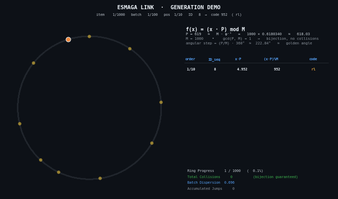
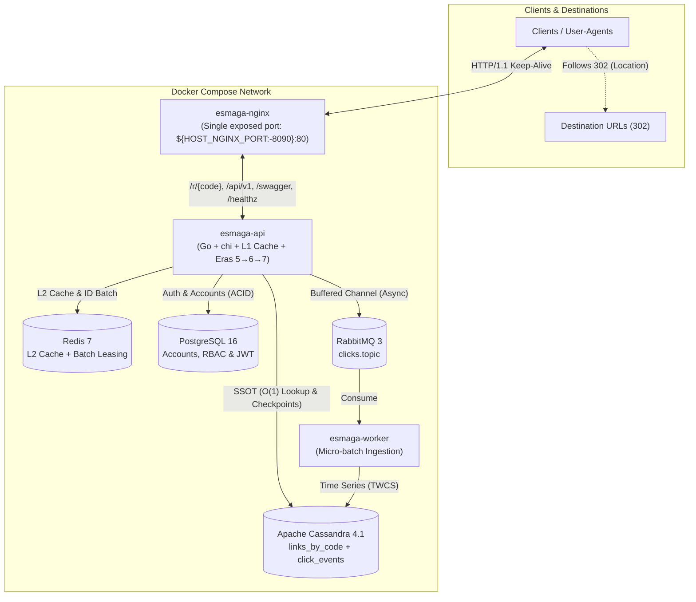

# Esmaga Link: High-Throughput URL Shortening and Telemetry Platform


> **Language / Idioma:** **English** | [Leia em Português (README.md)](README.md)

**Esmaga Link** is a distributed URL shortening and analytical telemetry platform engineered for ultra-high concurrency scenarios. Built on an event-driven architecture with strict workload isolation (CQRS), the system sustains low-latency redirects ($P99 < 50\text{ms}$).

At its core, it abandons random generators and database locks in favor of a **deterministic modular bijection** over a finite ring: $O(1)$ generation time, local reversibility without I/O, and **zero collisions by algebraic construction**.



*Each frame illustrates a batch of IDs being consumed in an intra-batch permuted order (a mechanism deliberately applied on every instance to prevent sequential correlation), whose entropy is further amplified across multiple concurrent nodes. The yellow trail demonstrates that all 10 IDs already land dispersed across the ring prior to the first access, serving as visual proof that spatial dispersion is independent of consumption order.*

---

## Key Architectural Guarantees

| Property                         | Mechanism                                              | Practical Benefit                                       |
| :------------------------------- | :----------------------------------------------------- | :------------------------------------------------------ |
| **Zero collisions**              | Algebraic proof via $\gcd(P, M) = 1$ (Section 1.6)     | Eliminates `SELECT before INSERT` and retry loops       |
| **$O(1)$ generation**            | $f(x) = (x \cdot P) \bmod M$                           | Pure CPU arithmetic with zero network or disk I/O       |
| **Uniform dispersion**           | Multiplier derived from $\phi^{-1}$ (golden ratio)     | Prevents predictable sequential enumeration             |
| **Local reversibility**          | Modular inverse $P^{-1}$ via Extended Euclidean Alg.   | Direct in-memory decoding without database lookups      |
| ***Stateless* APIs**             | Redis Batch Leasing + in-memory `sync/atomic`          | Horizontal scaling with zero inter-node coordination    |
| **Hot Path $P99 < 50\text{ms}$** | CQRS + L1/L2 Cache + zero-allocation `302` response    | Asynchronous telemetry never degrades redirect latency  |
| **SSOT resilience**              | Cassandra as Single Source of Truth + LWT (Paxos)      | Automatic recovery against total Redis state loss       |

---

## Table of Contents

- [Esmaga Link: High-Throughput URL Shortening and Telemetry Platform](#esmaga-link-high-throughput-url-shortening-and-telemetry-platform)
  - [Key Architectural Guarantees](#key-architectural-guarantees)
  - [Table of Contents](#table-of-contents)
  - [1. The Mathematical Decision](#1-the-mathematical-decision)
    - [1.1. Why We Rejected Conventional Approaches](#11-why-we-rejected-conventional-approaches)
    - [1.2. The Solution: Progressive Eras and Bijective Mapping over a Finite Ring](#12-the-solution-progressive-eras-and-bijective-mapping-over-a-finite-ring)
    - [1.3. Uniform Dispersion and Constant Selection](#13-uniform-dispersion-and-constant-selection)
    - [1.4. Second Layer: Lexical Obfuscation](#14-second-layer-lexical-obfuscation)
    - [1.5. O(1) Reversibility](#15-o1-reversibility)
    - [1.6. Formal Proof of Collision Absence](#16-formal-proof-of-collision-absence)
  - [2. High-Level Architecture](#2-high-level-architecture)
  - [3. Technology Stack](#3-technology-stack)
  - [4. Operations and Scale](#4-operations-and-scale)
    - [4.1. Path Isolation (Hot vs. Cold)](#41-path-isolation-hot-vs-cold)
    - [4.2. Batch Leasing](#42-batch-leasing)
    - [4.3. Resilience and Recovery](#43-resilience-and-recovery)
  - [5. Edge Security](#5-edge-security)
  - [6. HTTP API Contracts](#6-http-api-contracts)
    - [6.1. Creating Shortcodes](#61-creating-shortcodes)
    - [6.2. Redirection (Hot Path)](#62-redirection-hot-path)
    - [6.3. Authenticated Flow via cURL](#63-authenticated-flow-via-curl)
  - [7. Testing and Verification](#7-testing-and-verification)
  - [8. How to Run](#8-how-to-run)

---

## 1. The Mathematical Decision

Every high-scale URL shortener must solve a fundamental dilemma: **how to generate short, unique codes in parallel, without inter-node coordination, without collisions, and without prior database queries?** Traditional approaches sacrifice at least one of these requirements.

### 1.1. Why We Rejected Conventional Approaches

| Approach                 | Complexity | Collisions | Reversible | Obfuscation | Structural Limitation                                    |
| :----------------------- | :--------: | :--------: | :--------: | :---------: | :------------------------------------------------------- |
| Central `AUTO_INCREMENT` |   $O(1)$   |    Zero    |    Yes     |    None     | Single point of contention; breaks *stateless* design    |
| UUID v4                  |   $O(1)$   | Negligible |    Yes     |    None     | 128 bits (too long for URLs); index fragmentation        |
| Truncated Hash (MD5/SHA) |   $O(1)$   |  **Yes**   |     No     |    Good     | Birthday Paradox; requires `SELECT before INSERT`        |
| Snowflake                |   $O(1)$   |    Zero    |    Yes     |    Weak     | Timestamp-sortable and predictable upon inspection       |
| NanoID / PRNG            |   $O(1)$   |  **Yes**   |     No     |    Good     | Non-reversible; requires uniqueness verification         |

The goal was to find a function $f: \mathbb{Z}_M \to \mathbb{Z}_M$ that is simultaneously **bijective** (guaranteed zero collisions), **invertible** (local reversal without database access), and **geometrically dispersed** (resistant to frequency-analysis inference). The solution is **modular bijective mapping over a finite ring**, calibrated via the golden ratio.

### 1.2. The Solution: Progressive Eras and Bijective Mapping over a Finite Ring

To deliver short codes from day one without wasting address space or risking collisions as the system grows, the generator organizes codes into **progressive length-based Eras ($5 \to 6 \to 7$ characters)**, left-padded with the first character of the alphabet:

- **Era 5 ($62^5$):** `916,132,832` (~916 million 5-character codes)
- **Era 6 ($62^6$):** `56,800,235,584` (~56.8 billion 6-character codes)
- **Era 7 ($62^7$):** `3,521,614,606,208` (~3.52 trillion 7-character codes)

Because each era enforces a distinct fixed length, **eras are strictly disjoint by size**—a 5-character code can never collide with a 6- or 7-character code, allowing **100% utilization of every $M_k = 62^k$ universe**.

Within each era, obfuscation uses a **full-period LCG (*Linear Congruential Generator*)** validated by the **Hull-Dobell Theorem**, computed in $O(\log n)$ time without iterative state:

$$\text{ID}_{\text{obfuscated}} = T^n(\text{seed}) \pmod{M_k}, \quad T(x) = (A \cdot x + C) \bmod M_k$$

Where:
- $n$ is the local index of `seqID` within the current era (leased in batches from Redis and permuted in memory).
- $A$ and $C$ satisfy all three Hull-Dobell conditions ($\gcd(C, M_k) = 1$, $(A - 1)$ divisible by all prime factors of $M_k$, and $4 \mid (A - 1)$), guaranteeing a **complete Hamiltonian cycle** across all of $\mathbb{Z}_{M_k}$.

### 1.3. Uniform Dispersion and Constant Selection

Within each era, the constants $(A, C)$ (or the coprime multiplier $P \approx M \cdot \phi^{-1}$ in multiplicative mode) ensure uniform spatial dispersion without predictable clustering:

$$\phi^{-1} = \frac{\sqrt{5} - 1}{2} \approx 0.6180339887\ldots$$

Consequently, unit increments fragment the logical space almost uniformly, emulating the appearance of randomness while preserving **determinism, full period, and zero collisions**.

### 1.4. Second Layer: Lexical Obfuscation

Encoding integers with ordered alphabets (`0123...XYZ`) exposes trivial patterns in the most significant digits. To eliminate this signature, the Base62 dictionary undergoes a **Fisher-Yates** shuffle seeded statically at compile time:

- **Standard Base62 alphabet:** `0123456789abcdefghijklmnopqrstuvwxyzABCDEFGHIJKLMNOPQRSTUVWXYZ`
- **System-permuted alphabet:** `zWv6UYRb9tIGpKVrc2EFw1lTHemsSjqC5a03DL7Z4QPBdJyNhiouAMXgfxn8Ok`

Combining modular bijection with a permuted alphabet prevents sequence prediction without simultaneous knowledge of the mathematical constants and the lexical vector.

### 1.5. O(1) Reversibility

By Bézout's Identity, $\gcd(P, M) = 1$ guarantees the existence of a unique modular multiplicative inverse $P^{-1}$ computed via the Extended Euclidean Algorithm:

$$(P \cdot P^{-1}) \equiv 1 \pmod M$$

With $P^{-1}$ precomputed **once at application startup**, any code is reversed back to its original sequential ID in sub-microseconds:

$$\text{ID}_{\text{seq}} = (\text{ID}_{\text{obfuscated}} \cdot P^{-1}) \pmod M$$

### 1.6. Formal Proof of Collision Absence

**Theorem.** The function $f(x) = (x \cdot P) \bmod M$ is strictly bijective if, and only if, $\gcd(P, M) = 1$.

**Proof.** Suppose, for the sake of contradiction, that there exist $x_1 \neq x_2$ with $x_1, x_2 \in [0, M-1]$ such that $f(x_1) = f(x_2)$:

$$(x_1 \cdot P) \equiv (x_2 \cdot P) \pmod M$$

By the definition of modular congruence, $M$ divides their difference:

$$M \mid P(x_1 - x_2)$$

Applying Euclid's Lemma with the premise $\gcd(P, M) = 1$:

$$M \mid (x_1 - x_2)$$

Since $x_1, x_2 \in [0, M-1]$, it follows that $\vert{}x_1 - x_2\vert{} < M$. The only multiple of $M$ within this interval is $0$, which implies $x_1 - x_2 = 0 \implies x_1 = x_2$, contradicting the initial hypothesis. $\blacksquare$

**Engineering consequences:**
- **Zero distributed locks:** every Go instance computes $f(x)$ locally without querying peer nodes.
- **Zero verification round-trips:** no prior `SELECT` is needed to check code existence before insertion.
- **Intrinsic uniqueness:** collision freedom is enforced by the algebra of $(P, M)$ rather than contended unique indexes.

---

## 2. High-Level Architecture

The topology applies **CQRS** (*Command and Query Responsibility Segregation*) to completely isolate the critical HTTP redirection path (*Hot Path*) from the asynchronous telemetry pipeline (*Cold Path*).



**Architectural pillars:**
1. ***Stateless* Go nodes:** any instance handles reads or writes with zero session affinity.
2. **Cassandra as SSOT (*Single Source of Truth*):** *masterless* storage with deterministic $O(1)$ reads via the `short_code` partition key.
3. **Redis as a volatile accelerator:** operates strictly as an L2 cache and ID-block lease coordinator.
4. **RabbitMQ as a load buffer:** absorbs traffic spikes without propagating *backpressure* to redirects.

---

## 3. Technology Stack

Persistence follows a **polyglot** model, mapping each domain to the engine offering the best CAP guarantees for its access pattern:

| Component              | Domain                       | Technical Rationale                                                                                                                                                                                                    |
| :--------------------- | :--------------------------- | :--------------------------------------------------------------------------------------------------------------------------------------------------------------------------------------------------------------------- |
| **Redis 7**            | L2 Cache & Batch Leasing     | In-memory atomic operations (`INCRBY`, `GET`, `SETEX`) eliminate contention during ID range allocation and keep warm reads around $\sim 1\text{ms}$.                                                                   |
| **Apache Cassandra 4.1** | URL Catalog & Telemetry    | *Wide-column*, *masterless* architecture. `links_by_code` partitions by `short_code` for $O(1)$ lookups; `click_events` uses **TWCS** (*Time-Window Compaction Strategy*) for optimized time-series ingestion.           |
| **PostgreSQL 16**      | Users, RBAC & Authentication | Strict ACID consistency. Isolates `bcrypt` verification and account management from the redirection critical path.                                                                                                     |
| **RabbitMQ 3**         | Analytics Event Bus          | AMQP messaging with native flow control, decoupling the HTTP `302` response from metric persistence during bursts $> 50,000\text{ req/s}$.                                                                             |

---

## 4. Operations and Scale

### 4.1. Path Isolation (Hot vs. Cold)

Monolithic systems degrade when telemetry writes (IP, *User-Agent*, *Referer*) compete for connections and IOPS with URL resolution. Esmaga Link decouples these flows:

**Hot Path (Redirection — $P99 < 50\text{ms}$):**
1. Nginx forwards requests to the API over persistent HTTP Keep-Alive connections; the `/r/{code}` route runs in isolation without heavy *middlewares* (no synchronous `Logger` or CORS overhead).
2. The API checks the **in-memory L1 cache** (`TTL = 30s`) first, falling back to the **L2 cache (Redis)** via a pre-warmed connection pool.
3. On a Redis *cache miss*, it queries Cassandra by partition key (`LocalOne`), populates L1, triggers background Redis warming, and responds `302 Found` solely via headers (`Location` and `Cache-Control`) with *zero body allocation*.
4. In parallel, it pushes the click event onto a buffered channel (`4096`) drained by a dedicated goroutine for **non-blocking** RabbitMQ publishing.

**Cold Path (Analytical Ingestion):**
1. Dedicated Go *workers* consume the `clicks.topic` queue.
2. Events are grouped by time window or batch size (*micro-batching*).
3. Writes are sequentially flushed into Cassandra SSTables.

### 4.2. Batch Leasing

To avoid the bottleneck of remote increments on every request, Go instances lease contiguous sequence ranges:

1. The instance requests a block from Redis: `INCRBY esmaga:counter:id_sequence 1000`.
2. The process claims exclusive local ownership of the range $[53001, 54000]$.
3. Concurrent *goroutines* consume the range via `sync/atomic.AddUint64` in nanoseconds without network traffic.

With `BATCH_SIZE = 1000`, the amortized coordination cost drops to **$0.001$ RTT per ID**, remaining negligible even at $10^5\text{ req/s}$.

> **Intra-batch permutation as a defense layer:** even when running a single instance, IDs within a leased block are consumed in a permuted order. This local shuffling prevents an attacker from inferring contiguous sequences from temporally close requests; in topologies with multiple concurrent instances, externally observed randomness increases even further. As shown in the opening GIF, modular bijection preserves uniform ring dispersion regardless of consumption order.

### 4.3. Resilience and Recovery

Because Redis stores state in memory, it is treated as disposable infrastructure. In the event of total state loss (unpersisted restart or node failure), integrity is automatically restored from Cassandra:

1. **Durable checkpoints:** on every batch lease, the *High-Water Mark* is persisted to `esmaga_link.id_checkpoints`.
2. **Boot auto-recovery:** if `esmaga:counter:id_sequence` is missing in Redis on startup, the API reads the latest checkpoint from Cassandra, adds a safety margin $\Delta = 2 \times \text{BatchSize}$, and reinitializes the atomic counter—preventing any sequence regression or overlap with historical codes.
3. **Final barrier via LWT (Paxos):** every link creation executes `INSERT INTO links_by_code ... IF NOT EXISTS`. If an anomaly attempts to reuse an active code, Cassandra rejects the write (`applied: false`), and the API discards the ID and immediately advances to the next sequence.

---

## 5. Edge Security

- **SSRF mitigation:** every submitted URL undergoes strict *parsing* and DNS resolution prior to persistence. Addresses resolving to private networks (RFC 1918), *loopback* (`127.0.0.0/8`, `::1`), or cloud metadata endpoints (`169.254.169.254`) are rejected at the edge.
- **Distributed Rate Limiting:** *Token Bucket* algorithm executed via atomic Lua scripts in Redis, mitigating L7 DoS attacks and abusive *scraping* without race conditions.
- **JWT Authentication (`HMAC-SHA256`):** management routes require a signed token; all credential verification happens in PostgreSQL, keeping expensive cryptographic operations completely out of the *hot path*.

---

## 6. HTTP API Contracts

| Method   | Endpoint               | Authentication | Description                                    |
| :------- | :--------------------- | :------------: | :--------------------------------------------- |
| `GET`    | `/swagger/index.html`  |     Public     | Interactive Swagger UI documentation (`swaggo`) |
| `GET`    | `/healthz`             |     Public     | API instance health check                      |
| `POST`   | `/api/v1/auth/register`|     Public     | Registers a new user                           |
| `POST`   | `/api/v1/auth/login`   |     Public     | Authenticates user and issues a JWT token      |
| `DELETE` | `/api/v1/auth/account` |      JWT       | Deletes the authenticated user's account       |
| `POST`   | `/api/v1/links`        | Optional / JWT | Shortens a new URL and returns its `short_code`|
| `GET`    | `/api/v1/links`        |      JWT       | Lists links owned by the authenticated user    |
| `PUT`    | `/api/v1/links/{code}` |      JWT       | Updates the original URL of an existing link   |
| `GET`    | `/r/{short_code}`      |     Public     | Redirects (`302 Found`) to the original URL    |

### 6.1. Creating Shortcodes

```http
POST /api/v1/links
Content-Type: application/json
```

```json
{
  "original_url": "https://www.long-example-domain.com/technical-article"
}
```

**Response (`201 Created`):**

```json
{
  "short_code": "CjINS",
  "original_url": "https://www.long-example-domain.com/technical-article",
  "is_active": true,
  "created_at": "2026-11-08T14:32:30.849Z"
}
```

### 6.2. Redirection (Hot Path)

```http
GET /r/{short_code}
```

**Response (`302 Found` — zero body):**

```http
HTTP/1.1 302 Found
Location: https://www.long-example-domain.com/technical-article
Cache-Control: private, max-age=90
```

### 6.3. Authenticated Flow via cURL

```bash
# 1. Obtain JWT
JWT_TOKEN=$(curl -s -X POST http://localhost:8090/api/v1/auth/login \
  -H "Content-Type: application/json" \
  -d '{"email":"admin@company.com","password":"StrongPassword123!"}' | jq -r '.token')

# 2. Create authenticated link
curl -s -X POST http://localhost:8090/api/v1/links \
  -H "Authorization: Bearer $JWT_TOKEN" \
  -H "Content-Type: application/json" \
  -d '{"original_url":"https://company.com/campaign-v1"}'
```

---

## 7. Testing and Verification

Mathematical invariants (coprimality, bijection, reversibility, and lexical shuffling) and concurrency safety are verified through deterministic test suites:

```bash
# Mathematical axiom and collision-freedom tests with race detector enabled
go test -v ./internal/idgen/... -race -count=1

# Full test suite with coverage report
go test -v ./... -coverprofile=coverage.out
```

---

## 8. How to Run

**Prerequisites:** Docker Engine 24.0+ and Docker Compose v2.20+ (Go 1.25+ optional for running tests locally).

```bash
# 1. Configure environment variables
cp .env.example .env

# 2. Spin up the entire stack from the repository root (Nginx, Go API, Cassandra, Redis, PostgreSQL, RabbitMQ, and Worker)
docker compose up -d --build
```

Only **Nginx** is exposed to the host (default port `8090`, configurable via `HOST_NGINX_PORT`). Container *entrypoints* idempotently run PostgreSQL DDL migrations, create Cassandra *keyspaces*/tables, and initialize the analytics consumers.

- **Swagger UI:** `http://localhost:8090/swagger/index.html`

**Quick smoke test:**

```bash
curl -i -X POST http://localhost:8090/api/v1/links \
  -H "Content-Type: application/json" \
  -d '{"original_url":"https://github.com"}'
```
